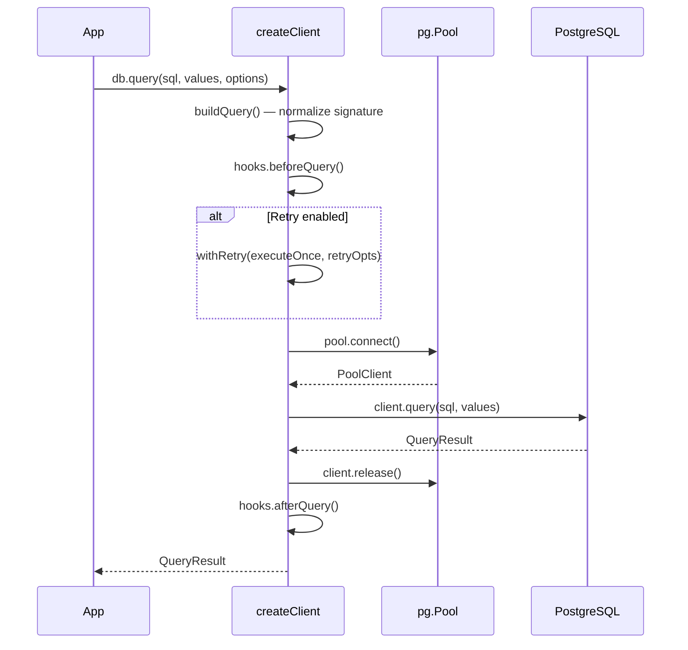
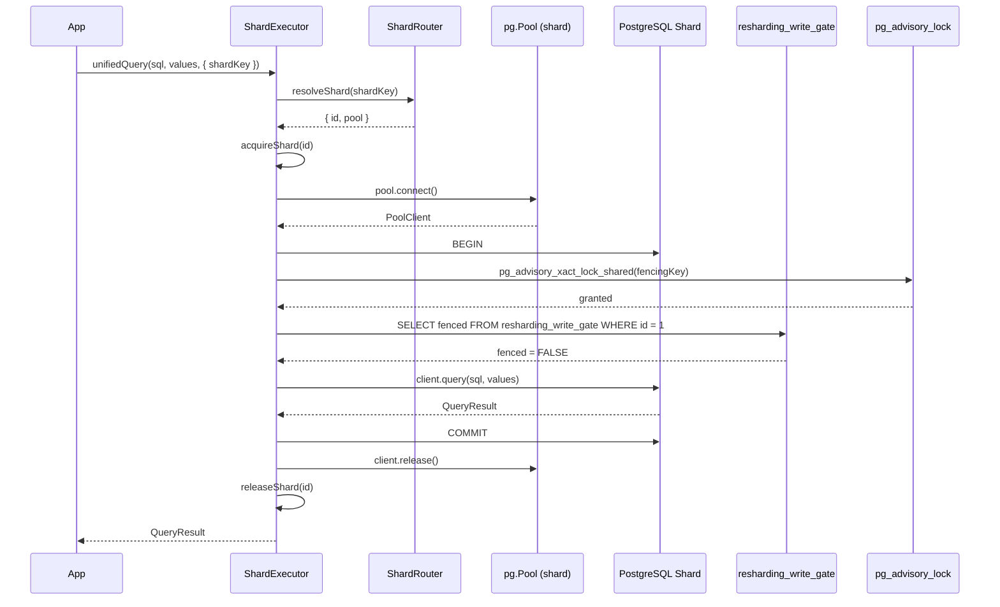
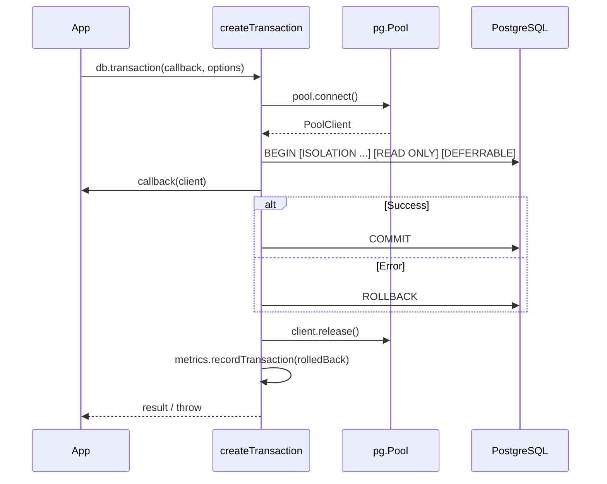
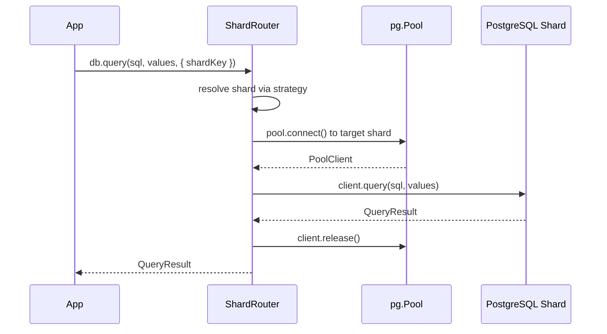
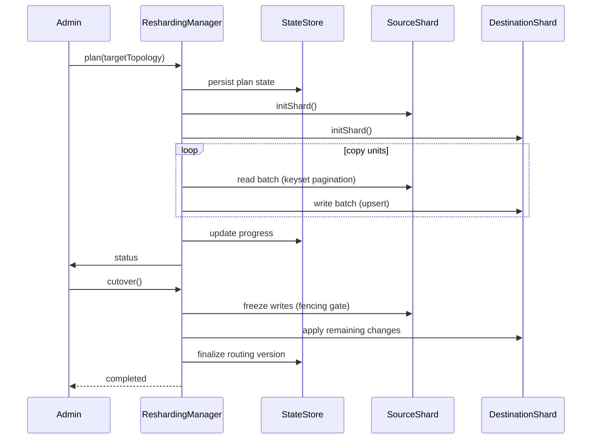
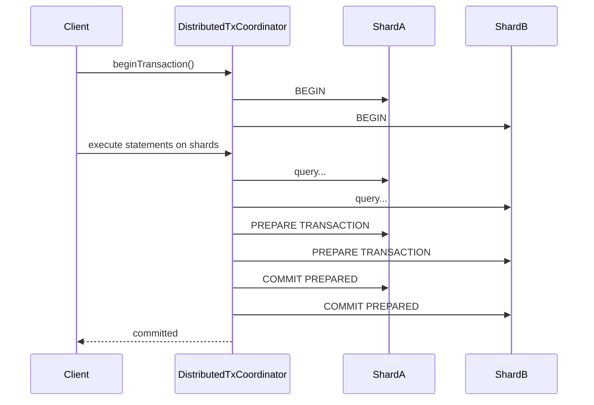
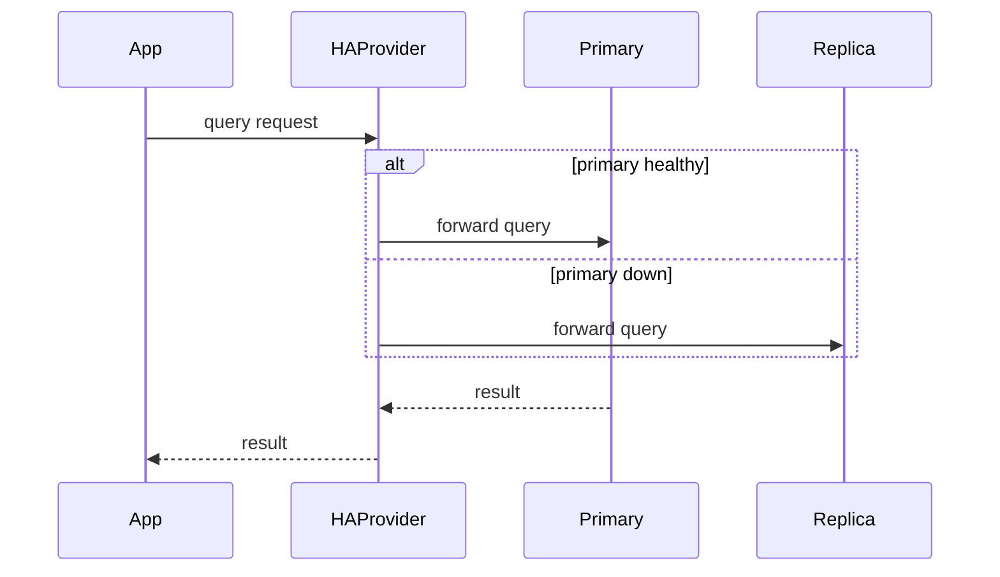
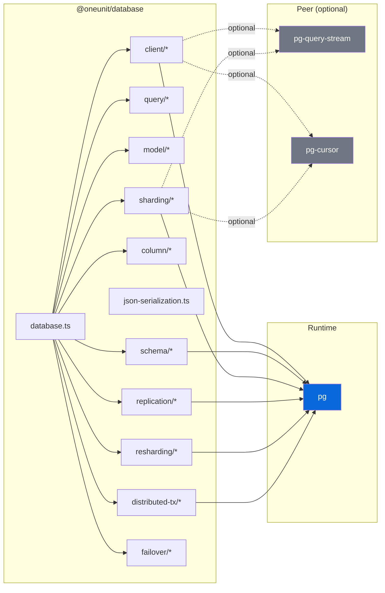

# Architecture

> Internal design reference for `@oneunit/database`. For usage, see [README.md](README.md).

---

## Table of Contents

- [Project Layout](#project-layout)
- [Design Principles](#design-principles)
- [When to Use Each Layer](#when-to-use-each-layer)
- [Composition Model](#composition-model)
- [Module Map](#module-map)
- [Core Client Layer](#core-client-layer)
- [Query Layer](#query-layer)
- [Model Layer](#model-layer)
- [Schema & Migration Layer](#schema--migration-layer)
- [Sharding Layer](#sharding-layer)
- [Replication Layer](#replication-layer)
- [Online Resharding Layer](#online-resharding-layer)
- [Distributed Transaction Layer](#distributed-transaction-layer)
- [Failover Layer](#failover-layer)
- [Data Flow Diagrams](#data-flow-diagrams)
- [Key Interfaces](#key-interfaces)
- [Error Architecture](#error-architecture)
- [Instrumentation & Metrics](#instrumentation--metrics)
- [Dependency Graph](#dependency-graph)
- [Testing Strategy](#testing-strategy)
- [Verification Checklist](#verification-checklist)
- [Publishing Checklist](#publishing-checklist)

---

## Project Layout

```
src/
├── index.ts                    # Public barrel — re-exports every public API
├── database.ts                 # createDatabase() — composes all subsystems
├── types.ts                    # All TypeScript interfaces and type declarations
├── json-serialization.ts       # JSON encode/decode, row/result serialization
├── pg-cursor.d.ts              # Ambient type shim for pg-cursor
│
├── client/                     # Connection & execution layer
│   ├── index.ts                # Barrel
│   ├── pool.ts                 # createPool() — pg.Pool from env+overrides
│   ├── config.ts               # loadDatabaseConfig(), parseSslConfig()
│   ├── client.ts               # createClient() — query, queryOne, prepare, retry
│   ├── transaction.ts          # createTransaction() — BEGIN/COMMIT/ROLLBACK
│   ├── batch.ts                # createBatch() — chunked multi-row INSERT
│   ├── stream.ts               # createStream() — pg-query-stream wrapper
│   ├── cursor.ts               # createCursor() — pg-cursor wrapper
│   ├── check.ts                # createCheck() — health & readiness
│   ├── shutdown.ts             # createShutdown() — idempotent pool close
│   ├── retry.ts                # createRetry(), withRetry()
│   ├── errors.ts               # normalizeError(), DatabaseError, classifiers
│   └── hooks.ts                # createHooks(), createMetrics()
│
├── query/                      # SQL construction layer
│   ├── index.ts                # Barrel
│   ├── sql.ts                  # sql`` tagged template, raw, identifier, join
│   └── builder.ts              # QueryBuilder — fluent SELECT/INSERT/UPDATE/DELETE
│
├── model/                      # Table abstraction layer
│   ├── index.ts                # Barrel
│   └── model.ts                # createModel(), createModelFactory()
│
├── schema/                     # DDL & migration layer
│   ├── index.ts                # Barrel
│   ├── schema.ts               # createSchemaManager() — facade
│   ├── introspect.ts           # Schema introspection helpers
│   ├── create.ts               # CREATE TABLE, CREATE INDEX
│   ├── alter.ts                # ALTER TABLE (add/drop/rename/alter columns)
│   ├── drop.ts                 # DROP TABLE, DROP INDEX
│   ├── constrain.ts            # UNIQUE, FOREIGN KEY, CHECK constraints
│   └── migrate.ts              # createMigrator() — versioned migration runner
│
├── column/                     # Column definition helpers
│   ├── index.ts                # Barrel
│   ├── id.ts                   # id(), bigIntId(), uuid()
│   └── timestamp.ts            # timestamp(...names)
│
├── sharding/                   # Multi-shard routing & execution
│   ├── index.ts                # Barrel + strategy exports
│   ├── shard-manager.ts        # ShardManager — pool lifecycle, drain state
│   ├── shard-router.ts         # ShardRouter — strategy dispatch, shard resolution
│   ├── shard-executor.ts       # ShardExecutor — routing + per-pool client cache
│   ├── shard-health.ts         # ShardHealth — per-shard health checks
│   ├── shard-metrics.ts        # ShardMetrics — per-shard counters
│   ├── shard-migration.ts      # ShardMigrationTracker — cross-shard migration status
│   ├── shard-rebalance-tracker.ts # ShardRebalanceTracker — rebalance progress tracking
│   ├── shard-execution-context.ts — ShardExecutionContext + OperationType
│   ├── strategies.ts           # All 9 shard strategy implementations
│   ├── errors.ts               # ShardNotFoundError, ShardConfigError, etc.
│   ├── schema-sync-types.ts    # Schema sync types (statuses, options, results, hooks)
│   ├── schema-sync-schema.ts   # SQL schema for coordination DB tables
│   ├── schema-version-tracker.ts # SchemaVersionTracker — per-shard schema version/checksum tracking
│   ├── schema-hash-calculator.ts # SchemaHashCalculator — deterministic schema checksums
│   ├── sync-lock-manager.ts    # SyncLockManager — distributed sync locking
│   ├── migration-applier.ts    # MigrationApplier — apply/rollback migrations per shard
│   ├── schema-validator.ts     # SchemaValidator — cross-shard consistency validation
│   ├── sync-state-store.ts     # SyncStateStore — durable sync operation state
│   ├── schema-sync-service.ts  # SchemaSyncService — main sync orchestration
│   ├── schema-rollback-coordinator.ts # SchemaRollbackCoordinator — coordinated rollback
│   ├── schema-sync-hooks.ts    # SchemaSyncHooks — lifecycle hook dispatch
│   ├── schema-sync-worker.ts   # SchemaSyncWorker — background consistency checks
│   ├── schema-sync-reporter.ts # SchemaSyncReporter — sync progress reporting
│   └── schema-sync-cli.ts      # SchemaSyncCLI — CLI for manual sync operations
│
├── replication/                # Primary / read-replica routing
│   ├── index.ts                # Barrel
│   ├── replication-manager.ts  # ReplicationManager — pools, health, lag
│   ├── replication-router.ts   # ReplicationRouter — read endpoint selection
│   └── errors.ts               # ReplicationConfigError, ReplicaUnavailableError, etc.
│
├── resharding/                 # Online data migration (durable lifecycle)
│   ├── index.ts                # (if barrel exists)
│   ├── resharding-manager.ts   # ReshardingManager — plan/start/validate/cutover/finalize
│   ├── resharding-store.ts     # Durable state on coordination DB
│   ├── resharding-planner.ts   # planResharding() — unit generation
│   ├── resharding-copier.ts    # keyset-paginated batch copy
│   ├── resharding-cutover.ts   # coordinated cutover (drain, fence, publish)
│   ├── resharding-change-capture.ts — transactional outlog (resharding_changes)
│   ├── resharding-schema.ts    # schema versioning + gate table
│   ├── resharding-types.ts     # MigrationDescriptor, ReshardingApi, etc.
│   └── resharding-errors.ts    # ReshardingError, UnsupportedStrategyError, etc.
│
├── distributed-tx/             # Cross-shard two-phase commit
│   ├── index.ts                # Barrel
│   ├── distributed-transaction-coordinator.ts — coordinator lifecycle
│   ├── distributed-transaction-context.ts — per-shard execution context
│   ├── coordinator-schema.ts   # coordination tables for prepared txns
│   ├── distributed-tx-hooks.ts — lifecycle hook dispatch + hook types
│   ├── participant-health.ts   # ParticipantHealthChecker — per-node health checks
│   ├── prepared-transaction-scanner.ts # pg_prepared_xacts scanner
│   ├── cleanup-diagnostics.ts  # TransactionCleanupManager — orphaned tx cleanup
│   ├── retry-policy.ts         # RetryPolicy — exponential backoff + jitter
│   ├── transaction-semaphore.ts # TransactionSemaphore — concurrent TX limiting
│   ├── circuit-breaker.ts      # CircuitBreaker — pool exhaustion protection
│   ├── connection-throttler.ts # ConnectionThrottler — per-TX connection limits
│   └── distributed-transaction-manager.ts # DistributedTransactionManager — managed TX entry point
│
└── failover/                   # High-availability provider & state machine
    ├── index.ts                # Barrel
    ├── failover-manager.ts     # FailoverManager — failover control
    ├── ha-provider.ts          # HAProvider — primary/replica switching
    ├── failover-state-machine.ts — ACTIVE/DRAINING/DRAINED/REMOVED states
    └── errors.ts               # Failover errors
```

---

## Design Principles

### 1. Composition over Inheritance

`createDatabase()` composes independent factory functions. Each subsystem (`client`, `transaction`, `schema`, `model`, `sharding`, `replication`, `resharding`, `distributed-tx`, `failover`) is a standalone unit that receives only its explicit dependencies. There are no base classes, no `this` binding, and no hidden shared state.

### 2. Explicit Configuration

Configuration flows through a strict precedence chain:

```
environment variables → alias fallbacks → hard-coded defaults → explicit overrides
```

`loadDatabaseConfig()` is the single source of truth. Credentials never appear in logs (the `sanitizeConnectionForLogging()` helper strips CA certificates and passwords).

### 3. Parameterized SQL Everywhere

All user values flow through `$1, $2, …` placeholders. The `sql` tagged template and `QueryBuilder` both enforce this — identifiers are quoted, values are never interpolated into SQL text.

### 4. Opt-in Retries

Retries are **off by default**. When enabled, only genuinely transient PostgreSQL errors are retried: serialization failures (`40001`), deadlocks (`40P01`), and connection-level errors. Non-idempotent writes should never use retries.

### 5. Idempotent Lifecycle

- `shutdown()` — safe to call multiple times; concurrent callers share one in-flight close
- `migrate.run()` — skips already-applied migrations under an advisory lock
- Pool creation is lazy — no connection is opened until the first query
- Resharding operations (`plan`, `start`, `pause`, `resume`, `cancel`, `validate`, `cutover`, `finalize`) are all durable and idempotent

### 6. Atomic Write Fencing

When an online resharding migration is active, writes to shards being migrated are protected by a shared advisory lock (`pg_advisory_xact_lock_shared`) acquired before checking the durable write gate table (`resharding_write_gate`). Cutover acquires an exclusive lock, which blocks until all shared-lock holders finish — eliminating TOCTOU races.

---

## Production Reliability Features

The following features have been implemented to ensure production-grade reliability:

### Connection Validation

**Location:** `src/client/pool.ts`

**Purpose:** Prevents errors from stale or broken connections that have been returned to the pool.

**Implementation:**
- Connections are wrapped with a Proxy that validates them on first query
- Validation executes `SELECT 1` to confirm the connection is alive
- If validation fails, the connection is released and an error is thrown
- This is **opt-in** via `validateConnections: true` to avoid breaking existing code

**Use Case:**
```javascript
const db = createDatabase({
    validateConnections: true, // Enable connection validation
});
```

**Trade-offs:**
- Adds one extra query per connection on first use
- Only validates when `query()` is called, not on `connect()`
- Prevents `ECONNRESET` and similar errors from stale connections

---

### Connection Leak Detection

**Location:** `src/client/pool.ts`, `src/client/client.ts`, `src/client/cursor.ts`

**Purpose:** Detects and warns about connections that are checked out but never released.

**Implementation:**
1. **Pool-level tracking:** All connections are tracked in a Set
2. **5-minute timeout:** If a connection is still in the Set after 5 minutes, a warning is logged with stack trace
3. **Manual client tracking:** Clients acquired via `getClient()` are tracked separately with the same timeout
4. **Cursor tracking:** Cursors have their own 5-minute timeout for leak detection

**Warning Output:**
```
[database] Connection leak detected
{
  message: 'Connection not released within 5 minutes',
  stack: 'Error: at file.js:line:column...',
  totalConnections: 10,
  idleConnections: 5
}
```

**API:**
```javascript
// Check active manual clients (for monitoring)
const activeCount = db.getActiveManualClientCount();
```

---

### Enhanced Pool Health Metrics

**Location:** `src/client/check.ts`

**Purpose:** Provides better visibility into connection pool status for monitoring and debugging.

**Extended Statistics:**
- `total`: Total number of connections in the pool
- `idle`: Number of idle connections
- `waiting`: Number of clients waiting for a connection
- `pendingAcquire`: Number of pending connection acquisitions (internal pg.Pool metric)
- `max`: Maximum pool size

**Use Case:**
```javascript
const health = await db.check();
// {
//   status: 'up',
//   latency: { value: 5, unit: 'ms' },
//   pool: {
//     total: 10,
//     idle: 7,
//     waiting: 0,
//     pendingAcquire: 0,
//     max: 20
//   }
// }
```

---

### Improved Retry Logic

**Location:** `src/client/retry.ts`

**Purpose:** Prevents retry storms when the pool is exhausted or connections are failing.

**Implementation:**
- Added `isRetryableError()` function that excludes pool-related errors
- Errors that are **NOT** retried:
  - `POOL_EXHAUSTED`: Pool has no available connections
  - `ECONNREFUSED` with 'pool' in message: Pool connection refused
  - `ECONNRESET`: Connection was reset
  - `ETIMEDOUT` with 'pool' in message: Connection timeout during pool acquisition

**Rationale:** These errors typically indicate:
1. The pool is at capacity (retrying will fail again)
2. The connection is fundamentally broken (retrying won't help)
3. A configuration issue (retrying won't resolve it)

**Use Case:**
```javascript
// Default: uses isRetryableError (excludes pool errors)
await db.query(sql, values, { retry: true });

// Custom: override with your own predicate
await db.query(sql, values, {
    retry: {
        retries: 3,
        shouldRetry: (error) => isTransientError(error) && !isPoolError(error),
    },
});
```

---

### Cursor Resource Management

**Location:** `src/client/cursor.ts`

**Purpose:** Prevents PostgreSQL server resource leaks from long-running or abandoned cursors.

**Implementation:**
1. **5-minute timeout:** Warns if cursor is held for more than 5 minutes
2. **30-second read timeout:** Individual read operations timeout after 30 seconds
3. **Automatic cleanup:** Cursor is closed when:
   - Iteration completes (for/await loop)
   - Error occurs during reading
   - `close()` is explicitly called
4. **Connection release:** Client connection is released when cursor closes

**Warning Output:**
```
[database] Cursor held for more than 5 minutes. This may indicate a leak.
Stack: Error: at file.js:line:column...
```

**Best Practices:**
```javascript
// Good: Always use try/finally or for/await
for await (const row of cursor) {
    process(row);
}
// Connection and cursor automatically cleaned up

// Good: Explicit cleanup
try {
    const cursor = await db.cursor(query);
    // process cursor
} finally {
    await cursor.close();
}

// Bad: Missing cleanup (will warn after 5 minutes)
const cursor = await db.cursor(query);
// Forgot to iterate or close
```

---

## When to Use Each Layer

This section provides guidance on when to enable and use each architectural layer based on your application's requirements, scale, and complexity.

### Decision Tree

```
Start
  │
  ├─ Single database? ── Yes ──► Use: client, query, model, schema, migrate
  │                         (Core features for most applications)
  │
  ├─ Need read scaling? ── Yes ──► Use: + replication
  │                         (Add read replicas for query load distribution)
  │
  ├─ Data exceeds single DB capacity? ── Yes ──► Use: + sharding
  │                                           (Partition data across multiple databases)
  │
  ├─ Need to add/remove shards without downtime? ── Yes ──► Use: + resharding
  │                                                           (Online data migration)
  │
  ├─ Need cross-shard transactions? ── Yes ──► Use: + distributed-tx
  │                                                 (Two-phase commit for atomicity)
  │
  └─ Need automatic failover? ── Yes ──► Use: + failover
                                        (High availability with primary/replica switching)
```

### Layer-by-Layer Usage Guide

#### Core Client Layer (`client/`)

**When to Use: ALWAYS**

The core client layer is the foundation of `@oneunit/database` and should be used by every application. It provides:

- Connection pooling via `pg.Pool`
- Query execution with parameterized SQL
- Transaction management (BEGIN/COMMIT/ROLLBACK)
- Savepoints for nested transactions
- Health checks and graceful shutdown
- Streaming and cursor support (with peer dependencies)
- Retry logic for transient errors
- Hooks and metrics for observability

**Architecture Pattern:** Single database, single connection pool

**Use Case Examples:**
- Small to medium applications
- Microservices with dedicated databases
- Serverless functions
- CLI tools and scripts

**Configuration Complexity:** Low
- Typically only requires `connectionString` or environment variables
- Optional: pool size, timeouts, SSL configuration

---

#### Query Layer (`query/`)

**When to Use: ALWAYS (Recommended)**

The query layer provides safe SQL construction and should be used alongside the core client layer:

- **`sql`` tagged template**: Safe SQL string construction with parameterized values
- **`QueryBuilder`**: Fluent API for building SELECT, INSERT, UPDATE, DELETE queries

**Architecture Pattern:** Works with any layer (client, sharding, replication)

**Use Case Examples:**
- All applications that need to construct dynamic queries
- Applications concerned with SQL injection prevention
- Type-safe query construction

**Configuration Complexity:** Low
- No configuration required; purely API-based

---

#### Model Layer (`model/`)

**When to Use: When you have CRUD-heavy operations**

The model layer provides a table-level CRUD abstraction that reduces boilerplate:

- `find()`, `findOne()`, `findById()` - Query operations
- `insert()`, `insertMany()` - Create operations
- `update()`, `updateById()` - Update operations
- `delete()`, `deleteById()`, `remove()` - Delete operations
- `count()`, `exists()` - Aggregation operations

**Architecture Pattern:** Works with single DB or sharded configurations

**Use Case Examples:**
- Applications with many tables following similar patterns
- Rapid development where boilerplate reduction is valuable
- Internal services with well-defined data models

**When NOT to Use:**
- Complex queries that don't fit the CRUD pattern
- Applications needing maximum query flexibility
- Bulk operations (use batch layer instead)

**Configuration Complexity:** Low
- Define table name and optional ID column

---

#### Schema & Migration Layer (`schema/`, `migrate/`)

**When to Use: When you need database schema management**

The schema and migration layers provide DDL (Data Definition Language) operations and versioned migrations:

- **Schema Manager**: CREATE/ALTER/DROP tables and indexes
- **Migrator**: Versioned migration runner with advisory locks
- **Column Helpers**: Pre-defined column types (id, uuid, timestamp)

**Architecture Pattern:** Works with any database topology

**Use Case Examples:**
- Applications that need to evolve their schema over time
- Development environments where schema changes are frequent
- CI/CD pipelines that deploy schema changes
- Multi-environment deployments (dev, staging, production)

**When NOT to Use:**
- Applications using external migration tools (Flyway, Liquibase, etc.)
- Schema managed by ORM (though can be used alongside)

**Configuration Complexity:** Medium
- Requires defining migrations as SQL strings or JavaScript functions
- Needs migration table in database

---

#### Batch Layer (`batch/`)

**When to Use: When inserting large datasets**

The batch layer provides efficient multi-row inserts:

- Chunked inserts that respect PostgreSQL's parameter limit (65,535)
- Configurable chunk sizes
- ON CONFLICT support for upserts
- RETURNING clause support

**Architecture Pattern:** Works with any database topology

**Use Case Examples:**
- Bulk data loading from CSV or API responses
- Event logging systems
- Data warehouse loading
- Any operation inserting hundreds or thousands of rows

**When NOT to Use:**
- Single-row or small inserts (use client.query directly)
- Updates or deletes (use QueryBuilder or raw SQL)

**Configuration Complexity:** Low
- Mainly chunkSize configuration

---

#### Replication Layer (`replication/`)

**When to Use: When you need read scaling**

The replication layer enables routing read queries to PostgreSQL read replicas:

- Primary/replica routing based on `readPreference`
- Three modes: `"primary"`, `"replica-preferred"`, `"replica-only"`
- Lag-aware health checks using `pg_last_xact_replay_timestamp()`
- Per-replica health monitoring
- Runtime add/remove of replicas

**Architecture Pattern:** Single primary with one or more read replicas

**Use Case Examples:**
- Read-heavy applications (analytics, reporting, dashboards)
- Applications where read load exceeds single DB capacity
- Geographic distribution of read traffic
- Disaster recovery scenarios (read from replica during primary outage)
- Caching layer replacement (use PostgreSQL replicas instead)

**When NOT to Use:**
- Write-heavy applications without read load
- Applications with strict read staleness requirements
- Deployments without replica infrastructure

**Configuration Complexity:** Medium
- Requires provisioning PostgreSQL replicas (streaming replication)
- Network configuration for replica connectivity
- Lag threshold tuning

**Infrastructure Requirements:**
- PostgreSQL primary with `wal_level = replica` or higher
- One or more PostgreSQL replicas with streaming replication configured
- Network connectivity between application and all replicas

---

#### Sharding Layer (`sharding/`)

**When to Use: When you need to partition data across multiple databases**

The sharding layer enables horizontal scaling by distributing data across multiple PostgreSQL databases (shards):

- Nine routing strategies for different data access patterns
- Per-shard connection pools
- Shard health monitoring
- Distributed drain coordination for safe shard removal
- Write fencing to prevent writes during resharding
- Add/remove shards at runtime

**Architecture Pattern:** Multiple independent PostgreSQL databases

**Use Case Examples:**
- Multi-tenant SaaS applications (tenant isolation)
- High-volume applications exceeding single DB write capacity
- Data residency requirements (geographic partitioning)
- Time-series data with natural temporal partitioning
- Applications with data that naturally partitions (by user, region, customer, etc.)

**When NOT to Use:**
- Applications that fit within a single database
- Applications requiring frequent cross-shard queries (joins, aggregations)
- Without careful shard key selection (avoid hot spots)
- When network latency between application and shards is high

**Configuration Complexity:** High
- Requires designing shard key strategy
- Application logic must be shard-aware
- Cross-shard operations need special handling

**Infrastructure Requirements:**
- Multiple PostgreSQL instances (one per shard)
- Network connectivity to all shards
- Coordination database (optional, for distributed state)
- Monitoring for per-shard health

**Strategy Selection Guide:**

| Strategy | Best For | Key Distribution | Remapping on Change | Complexity |
| :--- | :--- | :--- | :--- | :--- |
| `hash` | General purpose, even distribution | Hash modulo N | Most keys remap | Low |
| `consistent-hash` | Cache-like, minimal remapping | Hash ring with virtual nodes | ~1/(N+1) keys remap | Medium |
| `rendezvous` | General purpose, deterministic | Highest random weight | Most keys remap | Low |
| `range` | Ordered data (time, IDs) | Explicit numeric/string ranges | Only boundary keys remap | Medium |
| `directory` | Known key→shard mapping | Explicit lookup table | Only affected keys remap | Medium |
| `tenant` | Multi-tenant SaaS | Tenant ID → shard mapping | Only affected tenants remap | Low |
| `composite` | Multi-component keys | Serialized composite key | Depends on component changes | Medium |
| `geographic` | Data residency | Region → eligible shards | Only affected regions remap | Low |
| `weighted` | Uneven capacity | Weighted random-walk | Most keys remap | Low |

---

#### Online Resharding Layer (`resharding/`)

**When to Use: When you need to change shard topology without downtime**

The online resharding layer provides durable, crash-recoverable data migration when shard membership changes:

- Plan migration (define source, destination, tables)
- Keyset-paginated batch copy (bounded, resumable)
- Transactional change capture (no data loss during migration)
- Coordinated cutover (atomic routing version publish)
- Write fencing (prevent writes to migrating shards)
- Crash recovery (all operations durable and idempotent)

**Architecture Pattern:** Existing sharded deployment + coordination database

**Use Case Examples:**
- Adding new shards to handle increased data volume
- Removing shards to reduce costs
- Rebalancing data across shards
- Changing sharding strategy
- Migrating to new database instances
- Zero-downtime shard maintenance

**When NOT to Use:**
- Simple applications without sharding
- Applications that can tolerate downtime for resharding
- When data volume is small enough for pg_dump/pg_restore
- For one-time migrations (manual process may be simpler)

**Configuration Complexity:** Very High
- Requires understanding of distributed systems concepts
- Coordination database setup
- Migration descriptor configuration
- Monitoring and troubleshooting complex workflows

**Infrastructure Requirements:**
- Existing sharded deployment
- Coordination PostgreSQL database
- Sufficient resources for parallel copy operations
- Monitoring for migration progress and health

**Lifecycle:**
```
planned → copying → catching_up → validating → ready_for_cutover → cutting_over → completed → finalized
```

Each state is durable and recoverable. Operations are idempotent and can be resumed after crashes.

---

#### Distributed Transaction Layer (`distributed-tx/`)

**When to Use: When you need atomic operations across multiple shards**

The distributed transaction layer implements two-phase commit (2PC) for cross-shard atomicity:

- **Two-phase commit** — PREPARE TRANSACTION on all participants, then COMMIT PREPARED (or ROLLBACK PREPARED on failure)
- **Configurable timeouts** — `prepareTimeoutMs`, `commitTimeoutMs`, `abortTimeoutMs`, `globalTimeoutMs` per phase with per-shard enforcement
- **Participant registration and status tracking** — durable coordination state per participant
- **Crash recovery** via durable coordination state
- **Automatic abort on any failure** — prepare timeout triggers automatic abort with ROLLBACK PREPARED cleanup
- **Retry policies** — `RetryPolicy` with exponential backoff + jitter, retryable error classification, `execute()`/`wrap()` patterns
- **Lifecycle hooks** — `DistributedTxHookRunner` with 16 hook types (`beforePrepare`, `afterPrepare`, `prepareFailed`, `beforeCommit`, `afterCommit`, `commitFailed`, `beforeAbort`, `afterAbort`, `abortFailed`, `onParticipantJoin`, `onParticipantLeave`, `onStateChange`, `onTimeout`, ...); error-isolated dispatch
- **Participant health checks** — `ParticipantHealthChecker` with per-node health status, consecutive failure/success tracking, unhealthy duration
- **Cleanup diagnostics** — `PreparedTransactionScanner` scans `pg_prepared_xacts`; `TransactionCleanupManager` diagnoses, cleans up orphaned/old transactions (with dry-run support), generates recommendations

**Architecture Pattern:** Multi-shard deployment with 2PC support

**Use Case Examples:**
- Financial transactions across user accounts on different shards
- Inventory management across multiple warehouses (shards)
- Data consistency across partitioned datasets
- Any operation requiring atomicity across shard boundaries

**When NOT to Use:**
- Applications without sharding
- Operations that can tolerate eventual consistency
- High-throughput systems
- Deployments without proper PostgreSQL configuration

**Configuration Complexity:** Very High

**Infrastructure Requirements:**
- PostgreSQL with `max_prepared_transactions > 0` on all shards
- Coordination database for transaction state
- Network connectivity between all shards and coordinator
- Monitoring for prepared transaction state

**Usage Example:**
```typescript
import {
    DistributedTransactionCoordinator,
    RetryPolicy,
    DistributedTxHookRunner,
    ParticipantHealthChecker,
    PreparedTransactionScanner,
    TransactionCleanupManager,
} from "@oneunit/database";

const coordinator = new DistributedTransactionCoordinator({
    coordinationPool,
    timeouts: { prepareTimeoutMs: 30_000, commitTimeoutMs: 30_000, abortTimeoutMs: 30_000, globalTimeoutMs: 300_000 },
    retryPolicy: new RetryPolicy({ maxRetries: 3, initialDelayMs: 100, maxDelayMs: 5_000 }),
    hookRunner: new DistributedTxHookRunner(logger),
    logger,
});
await coordinator.initialize();

const txId = await coordinator.begin();
await coordinator.addParticipant(txId, "shard-1", pool1);
await coordinator.addParticipant(txId, "shard-2", pool2);
await coordinator.prepare(txId);
await coordinator.commit(txId);
```


**Performance Considerations:**
- 2PC adds latency (two round-trips instead of one)
- Prepared transactions hold locks until committed
- Not suitable for high-frequency cross-shard operations
- Consider eventual consistency alternatives where possible

---

#### Schema Auto-Sync Layer (`sharding/` schema-sync files)

**When to Use: When you need all shards to stay on the same schema version**

Schema Auto-Sync keeps every shard in a sharded deployment on an identical schema. When a migration is applied, it is automatically propagated to all shards, with checksums tracked per shard for consistency validation and distributed locking to prevent concurrent syncs.

- **SchemaSyncService** — Orchestrates the full sync workflow: lock → prepare → check → apply → validate → complete/rollback
- **SchemaVersionTracker** — Records and reads per-shard schema version + checksum in the coordination database
- **SchemaHashCalculator** — Computes deterministic SHA-256 checksums of schema definitions for drift detection
- **MigrationApplier** — Applies or rolls back a migration on an individual shard, wrapped in a transaction with checksum validation
- **SchemaValidator** — Compares version and checksum across all shards; produces a consistency report with inconsistent/missing shard lists
- **SyncLockManager** — Distributed advisory lock (`schema_sync_global`, `schema_sync_<version>`) to serialize concurrent sync operations
- **SyncStateStore** — Durable persistence of sync operation state (pending/applying/validating/completed/failed/rolled_back)
- **SchemaRollbackCoordinator** — Coordinated rollback of a migration across all shards that successfully applied it
- **SchemaSyncHooks** — Lifecycle callbacks: `onSyncStart/Complete/Fail`, `onShardStart/Complete/Fail`, `onValidationStart/Complete`, `onRollbackStart/Complete`
- **SchemaSyncWorker** — Background periodic consistency check with optional auto-repair of inconsistencies
- **SchemaSyncReporter** — Human-readable sync progress and status reports
- **SchemaSyncCLI** — CLI commands: sync, validate, rollback, status, history, repair
- **SchemaSyncSchema** — SQL for coordination tables: `schema_sync_state`, `shard_schema_versions`, `schema_sync_locks`, `migration_checksums`

**Configuration** (via `createDatabase()` `schemaSync` option):

```typescript
const db = createDatabase({
    sharding: { enabled: true, strategy: "hash", shards: [...] },
    schemaSync: {
        enabled: true,
        coordinationPool: coordinationPool,
        timeoutMs: 300_000,
        shardTimeoutMs: 60_000,
        maxRetries: 3,
        skipUnavailableShards: false,
        continueOnError: false,
        validateConsistency: true,
        parallel: false,
        maxParallelShards: 10,
        worker: { enabled: true, intervalMs: 300_000, autoRepair: false },
        blockWritesOnInconsistency: false,
    },
});
```

**Workflow:**

```
1. Validate input + check for in-progress sync (distributed lock)
2. Acquire global sync lock
3. Create sync operation record; calculate migration checksum
4. Read current version for each shard; identify shards needing updates
5. Apply migration to each shard (sequential or parallel); record version/checksum
6. Validate all shards match expected version + checksum; generate consistency report
7. Mark operation completed/failed/rolled-back; invoke hooks; release lock
```

**Sync Statuses:** `pending` → `applying` → `validating` → `completed` | `failed` | `rolled_back` | `cancelling` → `cancelled`

---

#### Distributed Tx Connection Management Layer (`distributed-tx/`)

**When to Use: When running many concurrent distributed transactions across shards**

Distributed transactions hold one connection per participant shard for the transaction's lifetime. Under high concurrency this can exhaust connection pools. This layer provides connection management primitives:

- **TransactionSemaphore** — Limits concurrent distributed transactions; excess transactions queue and wait for a slot (`maxConcurrent` default: 5, `timeoutMs` default: 30s)
- **PoolMonitor** — Tracks per-pool utilization (total/idle/waiting/active/max) and notifies listeners on threshold crossings
- **CircuitBreaker** — Wraps a PoolMonitor; opens (blocks new TX) when any pool's utilization exceeds a threshold; transitions `CLOSED` → `OPEN` → `HALF_OPEN` → `CLOSED`
- **ConnectionThrottler** — Limits the number of connections a single transaction can hold across all shards (default: 100 per transaction)
- **DistributedTransactionManager** — Managed entry point combining a `DistributedTransactionCoordinator` with semaphore, circuit breaker, and pool monitor

```typescript
import {
    DistributedTransactionManager,
    PoolMonitor,
    TransactionSemaphore,
    CircuitBreaker,
    ConnectionThrottler,
} from "@oneunit/database";

const poolMonitor = new PoolMonitor(shardPools, {
    warningThreshold: 0.8,
    errorThreshold: 0.95,
    checkIntervalMs: 5_000,
});
poolMonitor.start();

const manager = new DistributedTransactionManager(coordinator, {
    poolMonitor,
    maxConcurrentTransactions: 5,
});

const result = await manager.transaction(async (tx) => {
    await tx.execute({ shardId: "shard-1" }, "UPDATE accounts SET balance = balance - $1 WHERE id = $2", [100, "user-1"]);
    await tx.execute({ shardId: "shard-2" }, "UPDATE accounts SET balance = balance + $1 WHERE id = $2", [100, "user-2"]);
});

console.log(manager.getStatus());
// { activeTransactions, queuedTransactions, circuitState, averagePoolUtilization, maxPoolUtilization }

manager.shutdown();
```

---

#### Failover Layer (`failover/`)

**When to Use: When you need high availability with automatic primary/replica switching**

The failover layer provides production-grade high-availability capabilities:

- **State machine** — Shard failover states (`healthy` → `suspect` → `primary_unavailable` → `failover_requested` → `promoting` → `verifying` → `primary_changed` → `recovering` → `failed`)
- **Persistent state storage** — `FailoverStateStore` with `PgFailoverStateStore` (PostgreSQL, optimistic concurrency, version history) and `MemoryFailoverStateStore` (testing); schema: `_database_ha_state`, `_database_ha_state_versions`, `_database_ha_locks`
- **State recovery after restart** — `FailoverRecoveryManager` with per-shard recovery locking, state validation, and auto-reconciliation
- **Connection invalidation** — `ConnectionTracker` tracks per-node connections; invalidates connections to the old primary before promotion, respects active transactions
- **Health-check failure classification** — `HealthCheckClassifier` categorizes errors (`connection_refused`, `connection_timeout`, `authentication_failed`, `server_error`, etc.) with severity, retryable, and failover-immediately flags
- **Failure detection thresholds** — `HealthCheckTracker` with per-node configurable consecutive failure/success thresholds, unhealthy duration, dynamic health check intervals
- **Lifecycle hooks** — `FailoverHookRunner` for before/after state change, before/after failover, before/after promotion, before/after health check hooks
- **Pool reconnection** — `PoolReconnector` reconnects primary and replica pools after failover with exponential backoff retry
- **Fencing integration** — `FencingProvider` / `AdvisoryLockFencingProvider` / `FencingManager` for advisory-lock-based node fencing during failover; `FENCING_SCHEMA` tables: `_database_fencing_locks`, `_database_fencing_history`
- **Event history** — `FailoverEventStore` with `PgFailoverEventStore` (PostgreSQL) and `MemoryFailoverEventStore` (testing); schema: `_database_ha_events` with query, cleanup, and statistics

**Architecture Pattern:** Replicated deployment with automatic failover

**Use Case Examples:**
- Mission-critical applications requiring 99.99%+ uptime
- Applications where manual failover is unacceptable
- Geographic redundancy with automatic traffic rerouting
- Disaster recovery scenarios
- Applications using managed database services with failover support

**When NOT to Use:**
- Applications that can tolerate manual failover
- Single database deployments
- Development/testing environments
- Without proper monitoring and alerting

**Configuration Complexity:** High
- Requires understanding of HA/DR concepts
- Integration with HA provider or external system
- Configuration of failover detection and timeouts

**Infrastructure Requirements:**
- PostgreSQL with automatic failover configured (Patroni, pg_autofailover, etc.)
- Or managed database service with failover support (RDS, Cloud SQL, etc.)
- Network configuration for failover detection
- Monitoring for primary/replica health

**Usage Example:**
```typescript
import { FailoverManager, PgFailoverStateStore, ConnectionTracker, HealthCheckClassifier } from "@oneunit/database";

const stateStore = new PgFailoverStateStore(coordinationPool);
const connectionTracker = new ConnectionTracker();
const classifier = new HealthCheckClassifier();

const failover = new FailoverManager({
    shardId: "shard-0",
    primaryPool: primaryPool,
    config: failoverConfig,
    logger,
    stateStore,
    connectionTracker,
    recoveryOptions: { autoReconcile: true },
});
await failover.initialize();
```

---

### Layer Combination Patterns

#### Pattern 1: Simple Single Database

**Layers:** client, query, model, schema, migrate

**Description:** The most common pattern for applications that fit within a single database.

**Infrastructure:**
- Single PostgreSQL instance
- Optional: Connection pooler (PgBouncer)

**Code Example:**
```javascript
const db = createDatabase({
    connectionString: process.env.DATABASE_URL,
    max: 20,
});
```

**When to Use:**
- Small to medium applications
- Microservices with dedicated databases
- Development and testing environments

---

#### Pattern 2: Read-Optimized Single Database

**Layers:** client, query, model, schema, migrate, replication

**Description:** Single primary database with read replicas for scaling read operations.

**Infrastructure:**
- Primary PostgreSQL instance
- One or more read replicas (streaming replication)
- Optional: Connection pooler per instance

**Code Example:**
```javascript
const db = createDatabase({
    replication: {
        enabled: true,
        mode: "replica-preferred",
        primary: { id: "primary", connection: { connectionString: "..." } },
        replicas: [
            { id: "replica-1", connection: { connectionString: "..." } },
            { id: "replica-2", connection: { connectionString: "..." } },
        ],
    },
});
```

**When to Use:**
- Read-heavy applications (10:1 read/write ratio or higher)
- Analytics and reporting workloads
- Geographic distribution of read traffic

---

#### Pattern 3: Sharded Application

**Layers:** client, query, model, schema, migrate, sharding

**Description:** Data partitioned across multiple shards based on a shard key.

**Infrastructure:**
- Multiple PostgreSQL instances (one per shard)
- Optional: Coordination database for distributed state
- Optional: Connection pooler per shard

**Code Example:**
```javascript
const db = createDatabase({
    sharding: {
        enabled: true,
        strategy: "tenant",
        defaultShardId: "shard-0",
        shards: [
            { id: "shard-0", connection: { connectionString: "..." } },
            { id: "shard-1", connection: { connectionString: "..." } },
        ],
    },
});
```

**When to Use:**
- Applications that have outgrown a single database
- Multi-tenant SaaS applications
- Data that naturally partitions

---

#### Pattern 4: Sharded + Replicated Application

**Layers:** client, query, model, schema, migrate, sharding, replication

**Description:** Each shard has its own primary and replicas for both write scaling and read scaling.

**Infrastructure:**
- Multiple shards, each with primary and replicas
- Optional: Coordination database
- Optional: Connection pooler per shard/instance

**Code Example:**
```javascript
const db = createDatabase({
    sharding: {
        enabled: true,
        strategy: "hash",
        shards: [
            {
                id: "shard-0",
                connection: { connectionString: "..." },
                replication: {
                    enabled: true,
                    mode: "replica-preferred",
                    replicas: [
                        { id: "shard-0-replica-1", connection: { connectionString: "..." } },
                    ],
                },
            },
            // ... more shards
        ],
    },
});
```

**When to Use:**
- Large-scale applications with both high write and read loads
- Applications requiring both sharding and read scaling
- Geographic distribution with sharding

---

#### Pattern 5: Enterprise-Grade Deployment

**Layers:** ALL (client, query, model, schema, migrate, sharding, replication, resharding, distributed-tx, failover)

**Description:** Full-featured deployment with all capabilities for maximum scalability, availability, and flexibility.

**Infrastructure:**
- Multiple shards, each with primary and replicas
- Coordination database
- HA/DR configuration
- Monitoring and alerting
- Load balancers

**Code Example:**
```javascript
const db = createDatabase({
    sharding: {
        enabled: true,
        strategy: "hash",
        coordination: { connectionString: "..." },
        shards: [/* shards with replication */],
    },
    failover: {
        enabled: true,
        provider: "custom",
    },
});
```

**When to Use:**
- Enterprise applications with strict SLA requirements
- Mission-critical systems requiring 99.99%+ uptime
- Applications with complex data consistency requirements
- Systems that need zero-downtime operations

---

## Composition Model

`createDatabase()` assembles the public `Database` object from independent factories:

```mermaid
graph TD
    CD["createDatabase(options)"]

    CD --> CP["createPool()"]
    CD --> CC["createClient(pool)"]
    CD --> CT["createTransaction(pool)"]
    CD --> CS["createStream(pool)"]
    CD --> CU["createCursor(pool)"]
    CD --> CK["createCheck(pool)"]
    CD --> SD["createShutdown(pool)"]
    CD --> CB["createBatch(query, tx)"]
    CD --> QB["createQueryBuilder(query)"]
    CD --> MF["createModelFactory(query)"]
    CD --> SM["createSchemaManager(pool)"]
    CD --> MG["createMigrator(pool)"]
    CD --> CH["createHooks(options)"]
    CD --> CR["createRetry(defaults)"]
    CD --> SH["ShardManager"]
    CD --> SR["ShardRouter"]
    CD --> SE["ShardExecutor"]
    CD --> RC["ReplicationManager"]
    CD --> RM["ReshardingManager"]
    CD --> DT["DistributedTransactionCoordinator"]

    CC -.->|query, queryOne, prepare| DB["Database"]
    CT -.->|transaction, savepoint| DB
    CS -.->|stream| DB
    CU -.->|cursor| DB
    CK -.->|check, health| DB
    SD -.->|shutdown| DB
    CB -.->|batch| DB
    QB -.->|from, table| DB
    MF -.->|model| DB
    SM -.->|schema| DB
    MG -.->|migrate| DB
    CH -.->|hooks, metrics| DB
    CR -.->|retry| DB
    SH -.->|shards| DB
    SR -.->|route| DB
    SE -.->|execute| DB
    RC -.->|replicate| DB
    RM -.->|reshard| DB
    DT -.->|distributed-tx| DB

    style CD fill:#0969da,color:#fff
    style DB fill:#22863a,color:#fff
```



Each factory receives only the dependencies it needs (pool, query function, logger). No factory has access to the full `Database` object.

---

## Module Map

### client/

| File | Factory | Produces | Key Dependencies |
| :--- | :--- | :--- | :--- |
| `pool.ts` | `createPool()` | `pg.Pool` | `pg`, config |
| `config.ts` | `loadDatabaseConfig()` | `DatabaseConfig` | `process.env` |
| `client.ts` | `createClient()` | `query`, `queryOne`, `prepare`, `prepared` | pool, hooks, retry |
| `transaction.ts` | `createTransaction()` | `transaction`, `savepoint` | pool, hooks, retry |
| `batch.ts` | `createBatch()` | `batch.insertMany` | query, transaction |
| `stream.ts` | `createStream()` | `stream` | pool, `pg-query-stream` |
| `cursor.ts` | `createCursor()` | `cursor` | pool, `pg-cursor` |
| `check.ts` | `createCheck()` | `check`, `health` | pool |
| `shutdown.ts` | `createShutdown()` | `shutdown` | pool |
| `retry.ts` | `createRetry()`, `withRetry()` | `RetryApi` | error classifiers |
| `errors.ts` | `normalizeError()` | `DatabaseError`, classifiers | — |
| `hooks.ts` | `createHooks()`, `createMetrics()` | `QueryHooks`, `MetricsCollector` | logger, instrumentation config |

### sharding/

| File | Factory / Class | Produces | Key Dependencies |
| :--- | :--- | :--- | :--- |
| `shard-manager.ts` | `ShardManager` | pool lifecycle, drain state | pg.Pool, config |
| `shard-router.ts` | `ShardRouter` | shard resolution via strategy | ShardManager, strategy |
| `shard-executor.ts` | `ShardExecutor` | routing + per-pool client cache | ShardManager, ShardRouter |
| `shard-health.ts` | `ShardHealth` | per-shard health checks | ShardManager, createCheck |
| `shard-metrics.ts` | `createShardMetrics()` | per-shard counters | hooks |
| `shard-migration.ts` | `ShardMigrationTracker` | cross-shard migration status | ShardManager |
| `strategies.ts` | `createShardStrategy()` | strategy instances | — |
| `errors.ts` | error classes | Shard errors | — |

### replication/

| File | Factory / Class | Produces | Key Dependencies |
| :--- | :--- | :--- | :--- |
| `replication-manager.ts` | `ReplicationManager` | pools, health, lag | pg.Pool, config |
| `replication-router.ts` | `ReplicationRouter` | read endpoint selection | health states |
| `errors.ts` | error classes | Replication errors | — |

### resharding/

| File | Factory / Class | Produces | Key Dependencies |
| :--- | :--- | :--- | :--- |
| `resharding-manager.ts` | `ReshardingManager` | plan/start/validate/cutover/finalize | coordination pool, ShardManager |
| `resharding-store.ts` | `ReshardingStore` | durable migration state | coordination pool |
| `resharding-planner.ts` | `planResharding()` | migration units | topology snapshots |
| `resharding-copier.ts` | `ReshardingCopier` | keyset-paginated batch copy | source + dest pools |
| `resharding-cutover.ts` | `ReshardingCutover` | coordinated cutover | store, change capture |
| `resharding-change-capture.ts` | `ReshardingChangeCapture` | transactional outlog | shard pools |
| `resharding-schema.ts` | `createReshardingSchema()` | schema versioning, gate table | — |
| `resharding-types.ts` | types | MigrationDescriptor, ReshardingApi | — |
| `resharding-errors.ts` | error classes | Resharding errors | — |

### distributed-tx/

| File | Factory / Class | Produces | Key Dependencies |
| :--- | :--- | :--- | :--- |
| `distributed-transaction-coordinator.ts` | `DistributedTransactionCoordinator` | 2PC lifecycle | coordination pool, timeouts, retry policy, hook runner |
| `distributed-transaction-context.ts` | `DistributedTransactionContext` | per-shard execution | shard pools |
| `coordinator-schema.ts` | schema | coordination tables | — |
| `distributed-tx-hooks.ts` | `DistributedTxHookRunner` | lifecycle hook dispatch | logger |
| `distributed-tx-hooks.ts` | `DistributedTxHookType` / `DistributedTxHookContext` / `DistributedTxHookData` / `DistributedTxHook` / `DistributedTxCoordinatorHookAPI` / `DistributedTxHooks` / `DistributedTxLogger` | hook types | — |
| `participant-health.ts` | `ParticipantHealthChecker` | per-node health checks | pool clients, logger |
| `participant-health.ts` | `ParticipantHealthStatus` / `ParticipantHealthOptions` / `ParticipantHealthLogger` | health types | — |
| `prepared-transaction-scanner.ts` | `PreparedTransactionScanner` | pg_prepared_xacts scanner | pg.Pool, logger |
| `prepared-transaction-scanner.ts` | `PreparedTransactionInfo` / `PreparedTransactionFilter` / `PreparedTransactionScannerOptions` / `PreparedTransactionScannerLogger` | scanner types | — |
| `cleanup-diagnostics.ts` | `TransactionCleanupManager` | orphaned/old transaction cleanup | pg.Pool, logger, scanner |
| `cleanup-diagnostics.ts` | `CleanupResult` / `CleanupDiagnosticsOptions` / `CleanupDiagnosticsLogger` | cleanup types | — |
| `retry-policy.ts` | `RetryPolicy` | retry with exponential backoff + jitter | — |
| `retry-policy.ts` | `RetryPolicyOptions` / `defaultIsRetryable` | retry types | — |
| `transaction-semaphore.ts` | `TransactionSemaphore` | limit concurrent distributed transactions | — |
| `circuit-breaker.ts` | `CircuitBreaker` | block new TX when pools near exhaustion | PoolMonitor |
| `connection-throttler.ts` | `ConnectionThrottler` | per-transaction connection limits | — |
| `distributed-transaction-manager.ts` | `DistributedTransactionManager` | managed TX entry point (semaphore + breaker + coordinator) | coordinator, PoolMonitor |

### sharding schema-sync/

| File | Factory / Class | Produces | Key Dependencies |
| :--- | :--- | :--- | :--- |
| `schema-sync-types.ts` | types | SchemaSyncStatus, SchemaSyncOptions, SchemaSyncResult, SchemaConsistencyReport, SchemaSyncHooks | — |
| `schema-sync-schema.ts` | SQL | `schema_sync_state`, `shard_schema_versions`, `schema_sync_locks`, `migration_checksums` tables | — |
| `schema-version-tracker.ts` | `SchemaVersionTracker` | per-shard schema version + checksum tracking | coordination pool |
| `schema-hash-calculator.ts` | `SchemaHashCalculator` | deterministic SHA-256 schema checksums | — |
| `sync-lock-manager.ts` | `SyncLockManager` | distributed sync locking | coordination pool |
| `migration-applier.ts` | `MigrationApplier` | apply/rollback migrations per shard | shard pools, transaction |
| `schema-validator.ts` | `SchemaValidator` | cross-shard schema consistency validation | shard pools |
| `sync-state-store.ts` | `SyncStateStore` | durable sync operation state | coordination pool |
| `schema-sync-service.ts` | `SchemaSyncService` | sync orchestration (lock → apply → validate → complete) | all above components |
| `schema-rollback-coordinator.ts` | `SchemaRollbackCoordinator` | coordinated rollback across shards | MigrationApplier, SyncStateStore |
| `schema-sync-hooks.ts` | `SchemaSyncHooks` | lifecycle hook dispatch | logger |
| `schema-sync-worker.ts` | `SchemaSyncWorker` | background periodic consistency check | SchemaSyncService, ShardManager |
| `schema-sync-reporter.ts` | `SchemaSyncReporter` | sync progress reports | — |
| `schema-sync-cli.ts` | `SchemaSyncCLI` | CLI for manual sync operations | SchemaSyncService |

### failover/

| File | Factory / Class | Produces | Key Dependencies |
| :--- | :--- | :--- | :--- |
| `failover-manager.ts` | `FailoverManager` | failover control | config, provider, optional stores |
| `ha-provider.ts` | `HAProvider` / `StaticHaProvider` / `PatroniHaProvider` | primary/replica switching | replication topology |
| `failover-state-store.ts` | `FailoverStateStore` / `PgFailoverStateStore` / `MemoryFailoverStateStore` | durable state per shard | pg.Pool (Pg impl) |
| `failover-state-machine.ts` | state machine | state transitions + validation | — |
| `failover-event-store.ts` | `FailoverEventStore` / `PgFailoverEventStore` / `MemoryFailoverEventStore` | failover event history | pg.Pool (Pg impl) |
| `failover-recovery.ts` | `FailoverRecoveryManager` | state recovery after restart | FailoverStateStore |
| `connection-tracker.ts` | `ConnectionTracker` | connection tracking + invalidation | pg PoolClient |
| `health-classifier.ts` | `HealthCheckClassifier` | failure categorization | — |
| `health-check-tracker.ts` | `HealthCheckTracker` | per-node failure thresholds | config, logger |
| `failover-hooks.ts` | `FailoverHookRunner` | lifecycle hook dispatch | logger |
| `pool-reconnector.ts` | `PoolReconnector` | pool reconnection after failover | pg.Pool, config provider |
| `fencing.ts` | `FencingProvider` / `AdvisoryLockFencingProvider` / `FencedError` | node fencing | pg.Pool |
| `fencing-manager.ts` | `FencingManager` | multi-provider fencing orchestration | FencingProvider |
| `errors.ts` | error classes | Failover errors | — |

### model/

| File | Factory | Produces |
| :--- | :--- | :--- |
| `model.ts` | `createModelFactory()` → `createModel()` | `Model` with CRUD methods |

Model methods: `find`, `findOne`, `findById`, `insert`, `insertMany`, `update`, `updateById`, `delete`, `deleteById`, `remove`, `removeById`, `count`, `exists`. Each accepts an optional `{ client }` for transactional use.

### schema/

| File | Factory | Produces |
| :--- | :--- | :--- |
| `schema.ts` | `createSchemaManager()` | `SchemaManager` facade |
| `create.ts` | — | `schema.create.table()`, `schema.create.index()` |
| `alter.ts` | — | `schema.alter.addColumns()`, `dropColumns()`, `renameColumn()`, `alterColumn()`, `renameTable()`, `unique()` |
| `drop.ts` | — | `schema.drop.table()`, `schema.drop.index()` |
| `constrain.ts` | — | `schema.constrain.unique()`, `foreignKey()`, `check()`, `dropConstraint()` |
| `migrate.ts` | `createMigrator()` | `migrate.run()`, `migrate.status()`, `migrate.rollback()` |

Migrations run under a PostgreSQL advisory lock. Each migration gets its own transaction. The migrations table is auto-created on first run.

### column/

| File | Exports |
| :--- | :--- |
| `id.ts` | `id()` → UUID PK, `bigIntId()` → BIGSERIAL PK, `uuid()` → UUID column |
| `timestamp.ts` | `timestamp(...names)` → TIMESTAMPTZ columns with `DEFAULT NOW()` |

### json-serialization

Standalone utilities for encoding/decoding rows and query results as JSON buffers:

`encode`, `decode`, `encodeToString`, `decodeFromString`, `serializeRow`, `deserializeRow`, `serializeQueryResult`, `deserializeQueryResult`

---

## Core Client Layer

### Connection Pooling (`client/pool.ts`)

`createPool()` merges explicit options with `loadDatabaseConfig()` (environment + aliases + defaults) and constructs a `pg.Pool`. It attaches event listeners for `connect`, `acquire`, `remove`, and `error` — logging connection lifecycle events without recording credentials. If `idleTransactionTimeout` is enabled, PostgreSQL's `idle_in_transaction_session_timeout` startup parameter is applied to every new physical connection.

### Query Client (`client/client.ts`)

`createClient()` normalizes all supported call shapes into a single `pg` `QueryConfig`:

- `query(sql, values, options)`
- `query({ text, values }, options)`
- `query({ name, text, values }, options)`
- `query(QueryInstance, options)`

The client wraps each execution in `executeOnce()` which:
1. Acquires a connection from the pool (with optional connect timeout)
2. Calls `hooks.beforeQuery(context)` to record start time and log the query
3. Executes the query via `runQuery()`, which enforces a per-query execution timeout
4. Calls `hooks.afterQuery(context)` on success, recording duration and row count
5. Calls `hooks.onQueryError(context, error)` on failure, recording the error
6. Releases the connection back to the pool (destroying it if a connection error occurred)

Retry logic is opt-in via `withRetry()`, which only retries errors classified as transient by `isTransientError()`.

### Configuration (`client/config.ts`)

`loadDatabaseConfig()` is the single source of truth for all environment access. Supported variables include `DATABASE_URL`, `DATABASE_HOST`, `DATABASE_PORT`, `DATABASE_NAME`, `DATABASE_USER`, `DATABASE_PASSWORD`, `DATABASE_POOL_MAX` (default `20`), `DATABASE_POOL_MIN` (default `0`), `DATABASE_CONNECTION_TIMEOUT` (default `5000`), `DATABASE_IDLE_TIMEOUT` (default `30000`), `DATABASE_QUERY_TIMEOUT`, `DATABASE_STATEMENT_TIMEOUT`, `DATABASE_SSL`, `DATABASE_SSL_CA`, and `DATABASE_APP_NAME`. Aliases (`PGHOST`, `PGPORT`, `PGDATABASE`, `PGUSER`, `PGPASSWORD`, `DB_MAX_CONN`, `DB_POOL_SIZE`, `DB_MIN_CONN`, `DB_CONN_TIMEOUT`, `DB_IDLE_TIMEOUT`) are checked as fallbacks.

### Hooks & Metrics (`client/hooks.ts`)

`createHooks()` builds the instrumentation surface. Parameter values are never logged unless `logParameters: true`. Query text is only logged when `logQueries: true`. The `MetricsCollector` tracks in-memory, allocation-free counters: `queries`, `errors`, `slowQueries`, `retries`, `transactions`, `rolledBackTransactions`, `totalDurationMs`, `maxDurationMs`, `lastDurationMs`.

### Retry (`client/retry.ts`)

`withRetry()` implements exponential backoff with jitter: `delay = base * factor^attempt`, capped at `maxDelay`, with `jitter` spread. It only retries when `shouldRetry(error)` returns true (default: `isTransientError()`). An `AbortSignal` can cancel the retry loop.

### Errors (`client/errors.ts`)

`normalizeError()` maps raw PostgreSQL error codes to structured `DatabaseError` instances with `.code`, `.detail`, `.hint`, `.constraint`, `.table`, `.column`, `.schema`, `.dataType`, `.severity`, `.position`, `.where`, `.routine`, `.sqlState`, `.transient`, and `.cause`. Classification helpers include `isUniqueViolation` (`23505`), `isForeignKeyViolation` (`23503`), `isNotNullViolation` (`23502`), `isCheckViolation` (`23514`), `isExclusionViolation` (`23P01`), `isSerializationFailure` (`40001`), `isDeadlock` (`40P01`), `isConnectionError`, `isConstraintViolation` (`23xxx`), and `isTransientError`.

---

## Query Layer

### SQL Tagged Template (`query/sql.ts`)

The `sql` tagged template produces a `SqlFragment` with `.text` and `.values`. All interpolated values are appended to `.values` and sent as `$1, $2, …` parameters — never interpolated into the SQL text.

**Core Helpers:**
- `sql.raw(text)` - Raw SQL (use with caution, only trusted input)
- `sql.identifier(name)` - Safely quote identifier
- `sql.quoteIdent(name)` - Quote identifier (alias)
- `sql.join(values)` - JOIN array for IN clauses
- `sql.isFragment(value)` - Check if value is a SqlFragment
- `sql.quoteString(value)` - Quote string literal

**Window Function Helpers:**
- `sql.rowNumber(partitionBy?, orderBy?)` - ROW_NUMBER() window function
- `sql.rank(partitionBy?, orderBy?)` - RANK() window function
- `sql.denseRank(partitionBy?, orderBy?)` - DENSE_RANK() window function
- `sql.window(name, { partitionBy, orderBy })` - Define a named window for reuse

**JSON Operator Helpers:**
- `sql.jsonGetText(column, path)` - Extract text from JSON
- `sql.jsonGet(column, path)` - Extract JSON value
- `sql.jsonContains(column, value)` - JSON contains value
- `sql.jsonContained(column, value)` - JSON contained in value
- `sql.jsonArrayLength(column, path?)` - JSON array length
- `sql.jsonObjectKeys(column)` - JSON object keys
- `sql.jsonPath(column, path)` - JSON path query

**Aggregation Helpers:**
- `sql.countDistinct(column)` - COUNT(DISTINCT column)
- `sql.stringAgg(column, delimiter)` - STRING_AGG
- `sql.arrayAgg(column)` - ARRAY_AGG
- `sql.jsonAgg(column)` - JSON_AGG
- `sql.jsonObjectAgg(key, value)` - JSON_OBJECT_AGG

**Utility:**
- `sql.quoteString(value)` - Quote string literal

**CASE Expression Helper:**
- `sql.caseWhen()` - Start building CASE expression with .when() and .else()

All interpolated values are automatically parameterized.

### Query Builder (`query/builder.ts`)

`createQueryBuilder()` returns a fluent, thenable `QueryBuilder`. The builder implements `.then()` so `await db.from("users").select()` works without explicitly calling `.execute()`.

**Core CRUD Methods:**
- `select(...columns)` - SELECT columns
- `distinct(value)` - DISTINCT modifier
- `distinctOn(columns)` - PostgreSQL DISTINCT ON
- `insert(values)` / `values(values)` - INSERT data
- `update(values)` - UPDATE data
- `delete()` - DELETE mode
- `returning(...columns)` - RETURNING clause
- `from(table)` - FROM table or subquery
- `execute()` - Execute the query
- `first()` - Execute and return first row
- `toSQL()` - Return { text, values } without executing

**Filtering & Conditions:**
- `where(column, operator, value)` - WHERE conditions
- `orWhere(column, operator, value)` - OR conditions
- `whereNull(column)` - WHERE NULL
- `whereNotNull(column)` - WHERE NOT NULL
- `whereIn(column, values)` - WHERE IN
- `whereRaw(fragment)` - Raw SQL WHERE clause
- `whereGroup(callback)` - Nested AND group
- `orWhereGroup(callback)` - Nested OR group
- `whereExists(subquery)` - EXISTS subquery
- `whereNotExists(subquery)` - NOT EXISTS subquery
- `whereInSubquery(column, subquery)` - IN subquery
- `whereNotInSubquery(column, subquery)` - NOT IN subquery

**Joins (9 types):**
- `join(table, on)` - INNER JOIN
- `innerJoin(table, on)` - INNER JOIN
- `leftJoin(table, on)` - LEFT JOIN
- `rightJoin(table, on)` - RIGHT JOIN
- `fullJoin(table, on)` - FULL JOIN
- `fullOuterJoin(table, on)` - FULL OUTER JOIN
- `leftOuterJoin(table, on)` - LEFT OUTER JOIN
- `rightOuterJoin(table, on)` - RIGHT OUTER JOIN
- `crossJoin(table)` - CROSS JOIN

**Common Table Expressions:**
- `with(name, query, columns?, materialized?)` - Add CTE
- `withRecursive(name, query, columns?)` - Add recursive CTE

**Window Functions:**
- `window(name, { partitionBy, orderBy, frame })` - Define named window

**Query Combination:**
- `union(query)` - UNION
- `unionAll(query)` - UNION ALL
- `intersect(query)` - INTERSECT
- `intersectAll(query)` - INTERSECT ALL
- `except(query)` - EXCEPT
- `exceptAll(query)` - EXCEPT ALL

**CASE Expressions:**
- `selectCase(alias, callback)` - CASE expression in SELECT

**JSON Operators:**
- `whereJson(column, operator, value)` - JSON operator WHERE
- `whereJsonContains(column, value)` - JSON contains
- `whereJsonContained(column, value)` - JSON contained

**Row Locking:**
- `forUpdate()` - FOR UPDATE
- `forNoKeyUpdate()` - FOR NO KEY UPDATE
- `skipLocked()` - SKIP LOCKED

**Grouping & Aggregation:**
- `groupBy(...columns)` - GROUP BY
- `having(column, operator, value)` - HAVING clause
- `orderBy(column, direction)` - ORDER BY
- `limit(value)` - LIMIT
- `offset(value)` - OFFSET

**Sharding:**
- `withShard(shardKey)` - Route to shard by key
- `withShardId(shardId)` - Route to specific shard

**Metadata & Context:**
- `withQueryContext(context)` - Add logging context
- `getQueryContext()` - Get current context
- `timeout(ms)` - Query timeout

**Subqueries:**
- `selectSubquery(subquery, alias)` - Subquery in SELECT
- `from(subquery, alias)` - Subquery in FROM

Shard pinning is available via `withShard(shardKey)` and `withShardId(shardId)`.

---

## Model Layer

**Note:** For comprehensive Model layer documentation, see [MODEL_LAYER_LIMITATIONS.md](MODEL_LAYER_LIMITATIONS.md).

### Model (`model/model.ts`)

`createModelFactory()` → `createModel(table, { idColumn })` produces a `Model` with **table-level CRUD abstraction**.

> **Important:** The Model layer is a **lightweight CRUD helper**, not a full ORM. It does NOT support relationships, joins, soft deletes, automatic timestamps, validation, hooks, or complex query conditions.

### Core Methods

- `find(where?, options?)` → `QueryResultRow[]` - Find by simple equality conditions
- `findOne(where?, options?)` → `QueryResultRow | null` - Find one record
- `findById(id, options?)` → `QueryResultRow | null` - Find by primary key
- `insert(data, options?)` → `QueryResultRow | null` - Insert single record
- `insertMany(rows, options?)` → `QueryResultRow[]` - Batch insert (chunks to respect parameter limits)
- `update(where, data, options?)` → `QueryResultRow[]` - Update matching records
- `updateById(id, data, options?)` → `QueryResultRow | null` - Update by primary key
- `delete(where, options?)` → `QueryResultRow[]` - Delete matching records
- `deleteById(id, options?)` → `QueryResultRow | null` - Delete by primary key
- `remove(where, options?)` → `QueryResultRow[]` - Alias for delete
- `removeById(id, options?)` → `QueryResultRow | null` - Alias for deleteById
- `count(where?, options?)` → `number` - Count matching records
- `exists(where?, options?)` → `boolean` - Check if records exist

### Transaction Support

Each method accepts an optional `{ client }` to run inside an existing transaction:

```javascript
const client = await db.getClient();
try {
    const user = await db.model('users').insert(
        { name: 'Alice' },
        { client } // Must pass transaction client
    );
    const profile = await db.model('profiles').insert(
        { user_id: user.id },
        { client } // Must pass same client
    );
} finally {
    db.releaseClient(client);
}
```

### Key Capabilities

The Model layer supports all common ORM features:

| Feature | Implemented via |
|---|---|
| **Relationships** (hasMany, belongsTo, hasOne, manyToMany) | `relationships` option |
| **Joins** | `join`/`innerJoin`/`leftJoin`/`rightJoin`/`fullJoin`/`crossJoin` methods |
| **Complex WHERE conditions** | `$gt`, `$lt`, `$in`, `$like`, `$ne`, `$null`, AND/OR groups |
| **Automatic transactions** | `{ atomic: true }` or `{ client }` option |
| **Soft deletes** | `softDelete` option |
| **Automatic timestamps** | `timestamps` option |
| **Data validation** | `validate` option |
| **Lifecycle hooks** | `hooks` option |
| **Type coercion** | `coerce` + `coerceTypes` options |
| **SQL JOINs on Model** | `{ queryBuilder }` option on find/count/exists |

**For detailed analysis, see [MODEL_LAYER_LIMITATIONS.md](MODEL_LAYER_LIMITATIONS.md).**

---

## Schema & Migration Layer

### Schema Manager (`schema/schema.ts`)

`createSchemaManager()` returns a facade with `create`, `alter`, `drop`, and `constrain` namespaces:

- `create.table(name, columns)`, `create.index(name, table, columns)`
- `alter.addColumns()`, `dropColumns()`, `renameColumn()`, `alterColumn()`, `renameTable()`, `unique()`
- `drop.table()`, `drop.index()`
- `constrain.unique()`, `foreignKey()`, `check()`, `dropConstraint()`

### Migrator (`schema/migrate.ts`)

`createMigrator()` runs versioned migrations under a PostgreSQL advisory lock:

1. Acquire `pg_advisory_lock(lockKey)`
2. `CREATE TABLE IF NOT EXISTS _migrations`
3. Load migrations from directory or inline array (loaded in filename order)
4. Filter out already-applied migrations (by id)
5. For each pending migration: `BEGIN`, execute up (SQL string or async function), `INSERT INTO _migrations`, `COMMIT`
6. Release advisory lock

Each migration runs inside its own transaction. The migrations table is auto-created on first run.

---

## Sharding Layer

### Overview

Sharding routes queries to different PostgreSQL databases (shards) based on a shard key. Each shard is an independent database with its own connection pool. Nine routing strategies are available:

| Strategy | Name | Best For | Key Characteristic |
| :--- | :--- | :--- | :--- |
| Hash | `hash` | General purpose | Deterministic modulo; remaps most keys when shard count changes |
| Consistent Hash | `consistent-hash` | Cache-like workloads | Ring with virtual nodes; minimal remapping on membership change |
| Rendezvous | `rendezvous` | General purpose | Highest random weight; deterministic ranking per key |
| Range | `range` | Ordered keys | Explicit numeric/string ranges; no silent fallback |
| Directory | `directory` | Known key→shard mapping | Exact lookup; configurable unknown-key policy |
| Tenant | `tenant` | Multi-tenant SaaS | Tenant ID → shard mapping; optional default shard |
| Composite | `composite` | Multi-component keys | Length-prefixed serialization to prevent collisions |
| Geographic | `geographic` | Data residency | Region → eligible shards; deterministic selection |
| Weighted | `weighted` | Uneven capacity | Weighted highest-random-weight |

### ShardManager (`sharding/shard-manager.ts`)

Manages per-shard `pg.Pool` instances, lifecycle state (`ACTIVE`/`DRAINING`/`DRAINED`/`REMOVED`), health state, and distributed drain coordination:

- **Pool creation**: One pool per shard config, created eagerly at construction
- **Shard lifecycle**: Tracks active operations (`activeOps`), registered operation IDs, and drain state
- **Distributed drain**: Uses `shard_drain_state` and `shard_active_ops` tables on a coordination database (or first shard pool). `acquireShard()` atomically registers an operation with `INSERT ... WHERE NOT EXISTS (draining = TRUE)`, preventing TOCTOU races
- **addShard() / removeShard()**: Serialized via mutex, bumps `routingVersion`, runs `onBeforeReshard`/`onAfterReshard` hooks. `removeShard()` marks draining, waits for active operations to complete (up to `abandonedOperationTimeoutMs`, default 5 min), then closes the pool
- **Coordination modes**: `strict` (requires coordination DB), `local-only` (local state only), `fail-closed` (rejects when coordination unavailable)

### ShardRouter (`sharding/shard-router.ts`)

Dispatches shard key resolution to the configured strategy:

- `resolveShardId(shardKey)` → shard ID via `strategy.resolveShard()`
- `resolveShard(shardKey)` → `{ id, pool }`
- `resolveDefaultShard()` → default shard if configured
- `validateStrategyConfig()` → delegates to strategy's `validate()`

### ShardExecutor (`sharding/shard-executor.ts`)

Single source of truth for shard routing resolution and per-pool client caching:

- `resolve(options)` → `{ context, pool, shardId }` — resolves via shardId, shardKey, or falls back to primary pool
- `getClientForPool(pool)` — caches one client per pool, reused across queries
- `acquireShard()` / `releaseShard()` — distributed drain tracking
- `withClient()` — executes a callback with a dedicated connection from the resolved pool

### ShardHealth (`sharding/shard-health.ts`)

Per-shard health checking with connectivity, readiness, and replication dimensions:

- Connectivity: `SELECT 1` succeeds → `healthy`
- Readiness: shard in `ACTIVE` state and connectivity healthy → `ready`
- Reports `status` (`up`/`down`), `latency`, pool stats (`total`, `idle`, `waiting`), error, code, `consecutiveFailures`, and `checkedAt`
- Health checks never throw — down shards are reported in the result

### Shard Strategies (`sharding/strategies.ts`)

All strategies implement `ShardStrategy` with `validate()` and `resolveShard()`:

- `HashShardStrategy` — FNV-1a 32-bit hash modulo shard count
- `ConsistentHashShardStrategy` — hash ring with virtual nodes
- `RendezvousShardStrategy` — highest random weight ranking
- `RangeShardStrategy` — explicit range boundaries
- `DirectoryShardStrategy` — exact key→shard lookup
- `TenantShardStrategy` — tenant ID → shard mapping
- `CompositeShardStrategy` — length-prefixed composite key serialization
- `GeographicShardStrategy` — region → eligible shards
- `WeightedShardStrategy` — weighted highest-random-weight

Custom strategies can be implemented directly (no global registry for user-defined strategies).

### Sharding API (`database.ts` → `buildShardingApi()`)

The `db.sharding` surface exposes:

- `enabled`, `strategy`, `routingVersion`, `shards`
- `getShard(id)`, `getShardForKey(key)`
- `query(shardKey, text, values, options)` — deprecated compatibility wrapper
- `transaction(shardKey, callback, options)` — deprecated compatibility wrapper
- `distributedTransaction(callback, options)` — two-phase commit across shards
- `shutdown()`, `health()`, `shardHealth(id)`
- `addShard(config, hooks)`, `removeShard(id, hooks)`
- `batchInsertMany(groups)` — per-shard batch inserts
- `fanOut({ query, values, shardIds, concurrency, merge, onShardError })` — parallel execution across shards
- `queryAllShards({ query, values, concurrency, merge })` — convenience wrapper
- `topology` — `snapshot()`, `validate()`, `planRebalance()`
- `metrics` — per-shard counters and routing observability
- `executeOnShard(id, callback)` — dedicated connection for DDL/admin
- `distributedTx` — coordinator instance
- `rebalanceTracker` — ShardRebalanceTracker instance for managing rebalance operations
- `isClosed`

### ShardRebalanceTracker (`resharding/resharding-tracker.ts`)

In-memory tracker for shard rebalance progress, providing primitives for creating, updating, querying, and completing rebalance operations. **Note**: This is an in-memory implementation — for production use, wrap with persistent storage.

**Key Features**:
- `createRebalance(sourceShardId, destinationShardId, totalKeys)` — Creates a new rebalance operation with unique ID
- `updateProgress(rebalanceId, update)` — Updates progress metrics (movedKeys, failedKeys, skippedKeys) with automatic percentage calculation
- `getRebalance(rebalanceId)` — Retrieves a specific rebalance operation
- `listRebalances()` — Lists all active rebalance operations
- `completeRebalance(rebalanceId)` — Marks a rebalance as completed
- `failRebalance(rebalanceId, error)` — Marks a rebalance as failed with error
- `cancelRebalance(rebalanceId)` — Cancels a rebalance operation
- `clearCompleted()` — Removes completed/failed/cancelled operations from memory

**ShardRebalanceProgress Interface**:
```typescript
{
  rebalanceId: string;           // Unique identifier
  sourceShardId: string;        // Source shard identifier
  destinationShardId: string;   // Destination shard identifier
  totalKeys: number;            // Total keys to migrate
  movedKeys: number;            // Successfully moved keys
  failedKeys: number;           // Failed key migrations
  skippedKeys: number;          // Skipped keys
  percentage: number;           // Completion percentage (0-100)
  status: "planning" | "copying" | "validating" | "cutting-over" | "completed" | "failed" | "cancelled";
  startedAt: string;            // ISO timestamp
  updatedAt: string;            // ISO timestamp
  estimatedCompletionAt?: string; // Optional estimated completion
  errors: string[];             // Error messages
}
```

**Automatic State Transitions**:
- Automatically transitions to `"completed"` when `movedKeys + failedKeys + skippedKeys >= totalKeys`
- Prevents state changes on terminal states (completed, failed, cancelled)
- Percentage is automatically recalculated when movedKeys or totalKeys change

### Write Fencing

When an online resharding migration is active, sharded writes acquire a shared advisory lock (`pg_advisory_xact_lock_shared`) before checking the durable `resharding_write_gate` table. If `fenced = TRUE`, the write is rejected with `WriteFencedError`. Cutover acquires an exclusive lock, blocking until all shared-lock holders finish.

---

## Replication Layer

### Overview

Replication routes queries between one PostgreSQL primary and zero or more read replicas. The package configures **client connections** to those replicas — it does not create, promote, or fail over replicas. Routing is driven entirely by an explicit `readPreference` on query options — **never** by parsing SQL.

This layer enables read scaling by distributing read queries across replicas while ensuring write operations always go to the primary. It provides lag-aware routing to avoid stale reads.

### ReplicationManager (`replication/replication-manager.ts`)

Manages one primary pool plus zero or more replica pools:

- Primary pool may be supplied externally (owned by `ShardManager` for sharded DBs) or created internally
- Replica pools are created and owned by the manager
- `readEndpoint(readPreference)` → endpoint for reads based on mode:
  - `"primary"` → always primary
  - `"replica-preferred"` → eligible replica, fall back to primary
  - `"replica-only"` → replica only; `null` if none eligible
- `writeEndpoint()` → always primary; throws `WriteToReplicaError` if routed to replica
- Health checks measure connectivity and replication lag (`pg_last_xact_replay_timestamp()`)
- `lagThresholdMs` excludes replicas whose known lag exceeds the threshold
- `addReplica()` / `removeReplica()` — runtime topology changes with drain-and-wait
- `validateReplicationConfig()` — validates configuration before use

**Configuration Options**:
```typescript
interface ReplicationManagerOptions {
  primary: PoolConfig;
  replicas: PoolConfig[];
  lagThresholdMs?: number;       // Default: 1000 (1 second)
  healthCheckIntervalMs?: number; // Default: 10000 (10 seconds)
}
```

### ReplicationRouter (`replication/replication-router.ts`)

Selects read endpoints based on `readPreference` and endpoint health/lag state. Rebuilt whenever health state changes (`syncRouter()`).

**Functions**:
- `isReplicaEligible(replica, lagThresholdMs)` — Checks if replica meets health and lag requirements
- `selectEndpoint(preference, endpoints)` — Selects appropriate endpoint based on preference

**Endpoint Types**:
```typescript
interface ReplicationEndpoint {
  id: string;
  pool: Pool;
  role: "primary" | "replica";
  healthStatus: "healthy" | "unhealthy" | "unknown";
  lagMs?: number;
  lastCheckedAt?: string;
}
```

### Replication API (`database.ts` → `buildReplicationApi()`)

The `db.replication` surface exposes:

- `enabled`: boolean — whether replication is configured
- `mode`: ReplicationMode — current replication mode
- `primaryEndpointId`: string — ID of the primary endpoint
- `replicaEndpointIds`: string[] — IDs of all replica endpoints
- `health()`: ReplicationHealthResult — overall health status
- `endpointHealth(id)`: ReplicationEndpointHealth — health of specific endpoint
- `primaryPool`: Pool — direct access to primary pool (bypasses router)
- `readEndpoint(preference)`: Pool | null — get endpoint based on preference
- `shutdown()`: Promise<void> — close all pools
- `isClosed`: boolean — whether replication is closed

**Error Types**:
- `ReplicationConfigError` — Invalid configuration
- `ReplicaUnavailableError` — No eligible replicas available
- `PrimaryUnavailableError` — Primary is unavailable
- `WriteToReplicaError` — Attempted to write to replica
- `ReadPreferenceError` — Invalid read preference specified

---

## Online Resharding Layer

### Overview

`@oneunit/database` includes a durable, crash-recoverable online resharding subsystem that redistributes existing records when shard membership or routing configuration changes. The coordination authority is a single PostgreSQL database (the `coordination` pool) that owns migration lifecycle state, units, checkpoints, change-log offsets, and published routing versions.

### ReshardingManager (`resharding/resharding-manager.ts`)

Enforces legal state transitions with optimistic concurrency control (version column) plus an advisory worker lock:

```
planned → copying → catching_up → validating → ready_for_cutover → cutting_over → completed → finalized
```

Operator-visible states: `paused`, `failed`, `cancelled`, `rollback_required`.

### Lifecycle Operations

| Operation | Description |
| :--- | :--- |
| `plan(descriptor, targetTopology)` | Captures source topology snapshot, generates migration units, persists plan |
| `start()` | Claims worker lock, transitions `planned` → `copying` |
| `pause()` | Transitions copying/catching_up/validating/ready_for_cutover → `paused` |
| `resume()` | Reclaims worker lock, transitions `paused` → `copying` |
| `cancel()` | Releases worker lock, transitions to `cancelled`, unfences writes |
| `validate(descriptor?)` | Replays change-log to consistency boundary, validates destination |
| `cutover()` | Verifies copy complete, drains change log, fences writes, publishes routing version atomically |
| `finalize()` | Transitions `completed` → `finalized`, releases worker lock |
| `getStatus()` | Returns durable migration status |
| `instrumentedTransaction(shardId, callback)` | Executes mutation + CDC capture atomically in one transaction |
| `isShardWriteFenced(id)` | Durable fence check (fail-closed if unverifiable) |

### Key Guarantees

- **Durable state**: Migration lifecycle, per-unit checkpoints, change-log offsets, and routing versions persisted on coordination database (versioned schema, idempotent init)
- **Bounded, resumable copy**: Keyset-paginated batches (never offset pagination), configurable batch size/concurrency/throttle/retries. Checkpoints advance only after destination write commits
- **Idempotent destination writes**: Adapters use upsert (`ON CONFLICT`) semantics; repeated delivery does not duplicate logical records
- **Change capture**: Transactional outlog (`resharding_changes`) records source mutations atomically with the source mutation, with stable sequence ordering
- **Coordinated cutover**: Verifies copy complete, drains change log to consistency boundary, fences writes for moved keys, publishes new routing version atomically. Writes briefly paused during drain/fence window
- **Crash recovery**: All operations durable and idempotent; restart during cutover inspects durable state to roll forward or require operator intervention

### ReshardingStore

Durable state layer on the coordination database. Tables include migration records, units, checkpoints, write gates, and routing versions. Uses advisory locks for schema initialization.

### ReshardingCopier

Keyset-paginated batch copy with configurable batch size, concurrency, throttle, retries, and timeouts. Validates counts, duplicates, checksums, and destination placement.

### ReshardingChangeCapture

Transactional outlog pattern. `recordChange(client, event)` writes change events through the same client as the source mutation, so they commit or roll back together.

### ReshardingCutover

Coordinated cutover: acquire write barrier (exclusive advisory lock), drain change log to consistency boundary, fence writes, publish routing version atomically.

---

## Distributed Transaction Layer

### Overview

Cross-shard two-phase commit (2PC) coordinator. Enables atomic transactions across multiple PostgreSQL databases (shards). Requires `max_prepared_transactions > 0` on all participating PostgreSQL servers. Throws `MaxPreparedTransactionsError` if not configured.

This layer is essential for maintaining data consistency when a single logical operation must update multiple shards atomically.

### DistributedTransactionCoordinator (`distributed-tx/distributed-transaction-coordinator.ts`)

Manages the 2PC lifecycle with comprehensive error handling and recovery:

1. **`begin(options)`** → Returns `{ transactionId, context }`
   - Generates unique transaction ID
   - Registers all participant shards
   - Creates durable transaction record
   
2. **`execute(transactionId, shardKey, text, values, options)`** via `DistributedTransactionContext`
   - Runs SQL on specific shard within the distributed transaction
   - Tracks statements for later prepare/commit/abort
   - Returns query results

3. **`prepare(transactionId)`** — Phase 1: PREPARE TRANSACTION
   - Executes `PREPARE TRANSACTION 'tx-id'` on all participant pools
   - If any participant fails to prepare, all others are rolled back
   - Durable state: `"prepared"`

4. **`commit(transactionId)`** — Phase 2: COMMIT PREPARED
   - Executes `COMMIT PREPARED 'tx-id'` on all participants
   - If commit fails on any participant, others are rolled back
   - Durable state: `"committed"`

5. **`abort(transactionId)`** — Rollback PREPARED
   - Executes `ROLLBACK PREPARED 'tx-id'` on all participants
   - Durable state: `"aborted"`

6. **`getStatus(transactionId)`** — Durable status inspection
   - Returns current state and participant statuses
   - Useful for recovery and monitoring

**Configuration Options**:
```typescript
interface DistributedTxCoordinatorOptions {
  prepareTimeoutMs?: number;   // Default: 30000 (30 seconds)
  commitTimeoutMs?: number;    // Default: 30000 (30 seconds)
  maxRetries?: number;          // Default: 3
}
```

### DistributedTransactionContext

Provides a fluent interface for executing SQL on specific shards within a distributed transaction:

```typescript
const { transactionId, context } = await db.distributedTx.begin();

try {
  // Execute on shard A
  const result1 = await context.execute(
    { shardKey: "user123" },
    "UPDATE users SET balance = balance - $1 WHERE id = $2",
    [100, "user123"]
  );

  // Execute on shard B
  const result2 = await context.execute(
    { shardId: "shard-b" },
    "UPDATE audits SET amount = amount + $1 WHERE user_id = $2",
    [100, "user123"]
  );

  // Prepare and commit
  await db.distributedTx.prepare(transactionId);
  await db.distributedTx.commit(transactionId);
} catch (error) {
  await db.distributedTx.abort(transactionId);
  throw error;
}
```

**Execute Options**:
```typescript
interface DistributedTransactionExecuteOptions {
  timeoutMs?: number;
  retryOnDeadlock?: boolean;
}
```

### Participant Management

**ParticipantContext Type**:
```typescript
interface ParticipantContext {
  shardId: string;
  pool: Pool;
  prepared: boolean;
  error?: Error;
}
```

The coordinator tracks all participants and their states throughout the 2PC lifecycle.

### Coordination Schema

Durable tables store transaction state, participant lists, and prepared transaction identifiers for crash recovery:

- `distributed_transactions` — Transaction records with state and timestamps
- `distributed_transaction_participants` — Participant shards and their states
- Uses advisory locks for coordination during state transitions

**States**: `"pending"` → `"prepared"` → `"committed"` | `"aborted"` | `"failed"`

### Error Types

- `DistributedTransactionError` — Base error type for distributed transaction failures
- `DistributedTxNotFoundError` — Transaction ID not found
- `DistributedTxAlreadyResolvedError` — Transaction already committed or aborted
- `MaxPreparedTransactionsError` — PostgreSQL `max_prepared_transactions` exceeded

---

## Failover Layer

### Overview

High-availability provider and state machine for managing primary/replica failover. Provides automatic and manual failover capabilities for PostgreSQL clusters with primary-replica replication. States: `healthy` → `suspect` → `primary_unavailable` → `failover_requested` → `promoting` → `verifying` → `primary_changed` → `recovering` → `failed`.

This layer enables applications to maintain availability during primary failures by automatically or manually promoting replicas to primary status.

### FailoverManager (`failover/failover-manager.ts`)

Controls failover operations, serializing topology changes via a mutex to ensure consistency:

- Manages HA provider instances (`StaticHaProvider`, `PatroniHaProvider`)
- Tracks current failover state
- Coordinates failover transitions through a validated state machine
- Runs periodic health checks on the primary
- Invalidates connections to the old primary before promotion
- Reconnects pools and applies fencing during failover
- Persists state and events to optional durable stores

**Key Functions** (exported from `failover/failover-state-machine.ts`):
- `createInitialFailoverState(shardId)` — Creates initial state for a new setup
- `applyFailoverTransition(state, toState, event)` — Applies a validated state transition
- `nextFailoverState(current, event)` — Computes the next state without applying
- `createFailoverEvent(shardId, fromState, toState, reason, triggeredBy)` — Creates a failover event

**Constructor options** (`FailoverManagerOptions`):
- `shardId`, `primaryPool`, `config` (`FailoverConfig`), `logger`
- `onStateChange`, `onFailoverComplete` — callbacks
- `stateStore` (`FailoverStateStore`) — durable state persistence
- `recoveryOptions` — state recovery on restart
- `connectionTracker` (`ConnectionTracker`) — per-node connection invalidation
- `eventStore` (`FailoverEventStore`) — failover event history
- `healthTracker` (`HealthCheckTracker`) — per-node failure thresholds
- `hooks` (`FailoverHookRunner`) — lifecycle hooks
- `poolReconnector` (`PoolReconnector`) — pool reconnection after failover
- `fencingManager` (`FencingManager`) — node fencing during failover

**Public API**:
- `initialize()` — recover state, discover topology, start health checks
- `getTopology()` — current HA topology from the provider
- `currentState` / `currentPrimary` / `currentGeneration` / `failoverState` — getters
- `requestManualFailover(reason)` — operator-initiated failover
- `reportPrimaryFailure(reason)` / `reportPrimarySuccess()` — query-path failure/success reporting
- `registerConnection(nodeId, shardId, client)` / `unregisterConnection(client)` — connection tracking
- `markInTransaction(client, txId)` / `markOutOfTransaction(client)` / `touch(client)` — transaction awareness
- `invalidatePrimaryConnections()` — invalidate connections to the current primary
- `getConnectionCount()` — total tracked connections
- `isFenced(nodeId)` / `getFencingStatus(nodeId)` — fencing checks
- `shutdown()` — stop health checks and clean up

### HA Providers

Two HA provider implementations are available (`failover/ha-provider.ts`):

**StaticHaProvider** — static configuration of the primary per shard. No automatic promotion; failover requires operator intervention (`supportsPromotion: false`).

**PatroniHaProvider** — integrates with Patroni via its REST API. Detects the primary and replicas, supports automatic promotion, verification, and topology generation (`supportsPromotion: true`).

**HaProvider interface**:
```typescript
interface HaProvider {
  readonly name: string;
  readonly supportsPromotion: boolean;
  readonly supportsTopologyGeneration: boolean;
  readonly supportsReplicationLag: boolean;
  initialize(): Promise<void>;
  discoverTopology(shardId: string): Promise<HaTopology>;
  checkNodeHealth(nodeId: string, connection: HaNodeInfo["connection"]): Promise<HaNodeStatus>;
  promoteReplica?(shardId: string, replicaId: string): Promise<HaNodeInfo>;
  verifyPrimary?(nodeId: string, expectedGeneration: number): Promise<boolean>;
  fenceOldPrimary?(oldPrimaryId: string): Promise<boolean>;
  getTopologyGeneration?(shardId: string): Promise<number>;
  shutdown(): Promise<void>;
}
```

### FailoverStateMachine (`failover/failover-state-machine.ts`)

Enforces legal state transitions.

**State types**:
```typescript
type FailoverState =
  | "healthy"
  | "suspect"
  | "primary_unavailable"
  | "failover_requested"
  | "promoting"
  | "verifying"
  | "primary_changed"
  | "recovering"
  | "failed";
```

**Transition rules**:
- `healthy` → `suspect` — failure detected
- `suspect` → `primary_unavailable` — continued failures past `suspectTimeoutMs`
- `primary_unavailable` → `failover_requested` — failover requested
- `failover_requested` → `promoting` — promotion started
- `promoting` → `verifying` — replica promoted
- `verifying` → `primary_changed` — new primary verified
- `primary_changed` → `recovering` — failover complete, recovering
- `recovering` → `healthy` — recovery complete

`failed` is terminal; `recovering` can return to `healthy`.

**Functions**: `isTerminalFailoverState(state)`, `isTransientFailoverState(state)` (`failed` is terminal; `suspect`, `primary_unavailable`, `failover_requested`, `promoting`, `verifying` are transient).

### Failover Topology

**Types** (`failover/failover-types.ts`):
```typescript
interface HaNodeInfo {
  id: string;
  role: "primary" | "replica" | "unknown";
  status: "up" | "down" | "unknown";
  lagMs: number | null;
  lagUnknown: boolean;
  lastCheckedAt: string;
  consecutiveFailures: number;
  connection: { host?: string; port?: number; database?: string; user?: string; connectionString?: string };
}

interface HaTopology {
  generation: number;
  primary: HaNodeInfo | undefined;
  replicas: HaNodeInfo[];
  clusterId: string | undefined;
  capturedAt: string;
}

interface FailoverConfig {
  enabled: boolean;
  provider: HaProvider;
  healthCheckIntervalMs?: number;
  failureThreshold?: number;
  recoveryThreshold?: number;
  suspectTimeoutMs?: number;
  promotionTimeoutMs?: number;
  verificationTimeoutMs?: number;
  maxPreparedTransactionAgeMs?: number;
  replicationLagThresholdMs?: number;
}

interface ShardFailoverState {
  shardId: string;
  state: FailoverState;
  currentPrimary?: string;
  currentGeneration: number;
  failoverEvents: FailoverEvent[];
  lastStateChange: string;
  lastCheckedAt?: string;
  consecutiveFailures: number;
  consecutiveSuccesses: number;
}
```

### Failover Events

**FailoverEvent type** (`failover/failover-types.ts`):
```typescript
interface FailoverEvent {
  id: string;
  shardId: string;
  fromState: FailoverState;
  toState: FailoverState;
  reason: string;
  triggeredBy: string;
  timestamp: string;
  metadata?: Record<string, unknown>;
}
```

The `FailoverEventStore` (`failover/failover-event-store.ts`) persists these plus health-check, promotion, connection-invalidation, and lock events with `FailoverEventType` values such as `state_change`, `failover_started`, `failover_completed`, `promotion_started`, `connection_invalidated`, `lock_acquired`, `lock_released`.

### Error Types (`failover/errors.ts`)

- `FailoverError` — base error type for failover failures
- `FailoverNotSupportedError` — operation not supported by current provider
- `SplitBrainPreventedError` — operation prevented to avoid split-brain
- `PrimaryNotVerifiedError` — primary status cannot be verified

### Usage Example

```typescript
import { FailoverManager, StaticHaProvider, PgFailoverStateStore, FAILOVER_STATE_SCHEMA } from "@oneunit/database";

// Execute the failover state schema against your coordination database first
await coordinationPool.query(FAILOVER_STATE_SCHEMA);

const provider = new StaticHaProvider(shardConfigs);
const stateStore = new PgFailoverStateStore(coordinationPool, logger);

const failover = new FailoverManager({
  shardId: "shard-0",
  primaryPool,
  config: {
    enabled: true,
    provider,
    healthCheckIntervalMs: 5_000,
    failureThreshold: 3,
    recoveryThreshold: 2,
    suspectTimeoutMs: 30_000,
  },
  logger,
  stateStore,
  recoveryOptions: { autoReconcile: true },
});

await failover.initialize();

// Get current topology
const topology = await failover.getTopology();
console.log("Primary:", topology.primary);

// Request a manual failover
await failover.requestManualFailover("planned maintenance");
```

### Production Considerations

- Use `PatroniHaProvider` for Patroni-managed clusters (automatic primary detection and promotion)
- Configure `healthCheckIntervalMs`, `failureThreshold`, `suspectTimeoutMs`, `promotionTimeoutMs`, `verificationTimeoutMs` to match your SLA
- Persist state across restarts with a `stateStore` (`PgFailoverStateStore` / `MemoryFailoverStateStore`)
- Use `ConnectionTracker` to invalidate connections to the old primary before promotion
- Use `PoolReconnector` to reconnect pools after failover with exponential backoff
- Use `FencingManager` with `AdvisoryLockFencingProvider` or `TableBasedFencingProvider` to block fenced nodes
- Record failover events with `PgFailoverEventStore` / `MemoryFailoverEventStore`
- Monitor health checks and fenced states; alert immediately on `failed`
- Test failover procedures regularly

---

## Data Flow Diagrams

### Query Execution (Non-Sharded)



### Query Execution (Sharded, with Write Fencing)



### Transaction Lifecycle



### Savepoints

Savepoints nest inside a transaction — they issue `SAVEPOINT name` / `RELEASE SAVEPOINT name` / `ROLLBACK TO SAVEPOINT name` without touching the outer `BEGIN` / `COMMIT`.

### Batch Insert Pipeline

```
db.batch.insertMany(table, rows, options)
  │
  ├─ inferColumns()        — union of all keys across all rows
  ├─ chunkSize             — min(options.chunkSize, floor(65535 / columns.length))
  │
  ├─ for each chunk:
  │   ├─ build VALUES ($1,$2,...), ($3,$4,...), ...
  │   ├─ append ON CONFLICT clause (if configured)
  │   ├─ append RETURNING clause (if configured)
  │   └─ execute via query()
  │
  └─ return collected results
```

### Migration Runner

```
db.migrate.run({ directory })
  │
  ├─ pg_advisory_lock(lockKey)
  ├─ CREATE TABLE IF NOT EXISTS _migrations
  ├─ load migrations from directory / inline array
  ├─ filter out already-applied (by id)
  │
  ├─ for each pending migration:
  │   ├─ BEGIN
  │   ├─ execute up (SQL string or async function)
  │   ├─ INSERT INTO _migrations
  │   └─ COMMIT
  │
  └─ pg_advisory_unlock(lockKey)
```

### Sharding Execution



### Resharding Lifecycle



### Distributed Transaction Coordination (2PC)



### Failover Handling



---

## Key Interfaces

### `Database` — the public API surface

```typescript
interface Database {
    pool: Pool;

    // Queries
    getClient(options?): Promise<PoolClient>;
    query<T>(text, values?, options?): Promise<QueryResult<T>>;
    queryOne<T>(text, values?, options?): Promise<T | null>;
    releaseClient(client?, error?): void;
    prepare(name, text): PreparedStatement;
    prepared(name, text, values?, options?): Promise<QueryResult>;

    // Transactions
    transaction<T>(callback, options?): Promise<T>;
    savepoint<T>(client, name, callback): Promise<T>;

    // Streaming
    stream(text, values?, options?): Promise<ReadableStream>;
    cursor(text, values?, options?): Promise<CursorHandle>;

    // Health & lifecycle
    check(options?): Promise<HealthCheckResult>;
    health(options?): Promise<HealthResult>;
    shutdown(options?): Promise<void>;

    // Batch
    batch: BatchApi;

    // Query builder
    from(table): QueryBuilder;
    table(table): QueryBuilder;         // alias of `from`

    // Models
    model(table, options?): Model;

    // Schema DDL
    schema: SchemaManager;

    // Migrations
    migrate: Migrator;

    // Instrumentation
    hooks: QueryHooks;
    metrics: MetricsCollector;
    retry: RetryApi;

    // Sharding
    sharding: ShardingApi;

    // Replication
    replication: ReplicationApi;

    // Online resharding (when sharding enabled)
    resharding?: ReshardingApi;
}
```

### `QueryBuilder`

Fluent, thenable query builder. Supports `select`, `distinct`, `insert`, `values`, `update`, `delete`, `returning`, `where`, `orWhere`, `whereNull`, `whereNotNull`, `whereIn`, `whereRaw`, `join`, `leftJoin`, `groupBy`, `having`, `orderBy`, `limit`, `offset`, `onConflict`, `toSQL`, `execute`, `first`, `then`. Shard pinning via `withShard()` / `withShardId()`.

### `Model`

Table-level CRUD abstraction: `find`, `findOne`, `findById`, `insert`, `insertMany`, `update`, `updateById`, `delete`, `deleteById`, `remove`, `removeById`, `count`, `exists`, `query`, `builder`, `select`.

### `SchemaManager`

```typescript
interface SchemaManager {
    create: { table(), index() };
    alter:  { addColumns(), dropColumns(), renameColumn(), alterColumn(), renameTable(), unique() };
    drop:   { table(), index() };
    constrain: { unique(), foreignKey(), check(), dropConstraint() };
}
```

### `ShardingApi`

Exposes `enabled`, `strategy`, `routingVersion`, `shards`, `getShard()`, `getShardForKey()`, `query()`, `transaction()`, `distributedTransaction()`, `shutdown()`, `health()`, `shardHealth()`, `addShard()`, `removeShard()`, `batchInsertMany()`, `fanOut()`, `queryAllShards()`, `topology`, `metrics`, `executeOnShard()`, `distributedTx`, `isClosed`.

### `ReplicationApi`

Exposes `enabled`, `mode`, `primaryEndpointId`, `replicaEndpointIds`, `health()`, `endpointHealth()`, `primaryPool`, `readEndpoint()`, `shutdown()`, `isClosed`.

### `ReshardingApi`

Exposes `migrationId`, `init()`, `initShard()`, `plan()`, `start()`, `getStatus()`, `pause()`, `resume()`, `cancel()`, `validate()`, `cutover()`, `finalize()`, `recordChange()`, `instrumentedTransaction()`, `drainChanges()`, `refreshRoutingVersion()`, `isWriteFenced()`, `shutdown()`, `isClosed`.

---

## Error Architecture

```
Error
└── DatabaseError (code, detail, hint, constraint, table, column, schema,
    dataType, severity, position, where, routine, sqlState, transient, cause)
    └── TimeoutError (timeout)
```

### Error Classification

All raw `pg` errors pass through `normalizeError()`, which maps PostgreSQL error codes to structured `DatabaseError` instances.

| Classifier | PostgreSQL Code | Transient? |
| :--- | :--- | :--- |
| `isUniqueViolation` | `23505` | No |
| `isForeignKeyViolation` | `23503` | No |
| `isNotNullViolation` | `23502` | No |
| `isCheckViolation` | `23514` | No |
| `isExclusionViolation` | `23P01` | No |
| `isSerializationFailure` | `40001` | Yes |
| `isDeadlock` | `40P01` | Yes |
| `isConnectionError` | connection-level | Yes |
| `isConstraintViolation` | `23xxx` family | No |
| `isTransientError` | any of the above | Yes |

Only errors flagged `transient: true` are eligible for automatic retry.

### Sharding Errors

| Error | Code | When |
| :--- | :--- | :--- |
| `ShardingDisabledError` | `SHARDING_DISABLED` | Sharding APIs called when disabled |
| `ShardNotFoundError` | `SHARD_NOT_FOUND` | Shard ID or key mapping not found |
| `ShardConfigError` | `SHARD_CONFIG_ERROR` | Invalid sharding configuration |
| `ShardRoutingError` | (none) | Query/transaction routing to a shard |
| `CrossShardTransactionError` | `CROSS_SHARD_TRANSACTION` | Cross-shard transaction via transaction API |
| `ShardNotReadyError` | `SHARD_NOT_READY` | Shard is draining or removed |
| `ShardCoordinationError` | `SHARD_COORDINATION_ERROR` | Coordination database unavailable |
| `ShardTopologyStaleError` | `SHARD_TOPOLOGY_STALE` | Routing version mismatch |
| `ShardOperationTimeoutError` | `SHARD_OPERATION_TIMEOUT` | Operation timed out |
| `ShardDrainTimeoutError` | `SHARD_DRAIN_TIMEOUT` | Shard drain exceeded timeout |
| `ShardMigrationPartialFailureError` | `SHARD_MIGRATION_PARTIAL_FAILURE` | Migration partially failed across shards |

### Resharding Errors

| Error | Code | When |
| :--- | :--- | :--- |
| `ReshardingError` | (varies) | General resharding failure |
| `UnsupportedStrategyError` | `UNSUPPORTED_STRATEGY` | Strategy planning |
| `MissingSchemaMetadataError` | `MISSING_SCHEMA_METADATA` | Missing table/column metadata |
| `StalePlanError` | `STALE_PLAN` | Routing version mismatch |
| `InvalidStateTransitionError` | `INVALID_STATE_TRANSITION` | Illegal lifecycle transition |
| `MigrationNotFoundError` | `MIGRATION_NOT_FOUND` | Migration ID not found |
| `MigrationAlreadyExistsError` | `MIGRATION_ALREADY_EXISTS` | Duplicate migration ID |
| `InconsistentRoutingVersionError` | `INCONSISTENT_ROUTING_VERSION` | Routing version inconsistency |
| `DestinationUnavailableError` | `DESTINATION_UNAVAILABLE` | Destination shard unavailable |
| `ValidationFailedError` | `VALIDATION_FAILED` | Validation did not pass |
| `UnsafeShardRemovalError` | `UNSAFE_SHARD_REMOVAL` | Safe shard removal |
| `UnrecoverableCutoverError` | `UNRECOVERABLE_CUTOVER` | Cutover requires intervention |
| `WriteFencedError` | `WRITE_FENCED` | Writes blocked by active migration |
| `MigrationLockedError` | `MIGRATION_LOCKED` | Worker lock held by another instance |

### Replication Errors

| Error | Code | When |
| :--- | :--- | :--- |
| `ReplicationConfigError` | `REPLICATION_CONFIG_ERROR` | Invalid replication configuration |
| `ReplicaUnavailableError` | `REPLICA_UNAVAILABLE` | No eligible replica available |
| `PrimaryUnavailableError` | `PRIMARY_UNAVAILABLE` | Primary endpoint unavailable |
| `WriteToReplicaError` | `WRITE_TO_REPLICA` | Write attempted on replica |
| `ReadPreferenceError` | `READ_PREFERENCE_ERROR` | Invalid read preference |

---

## Instrumentation & Metrics

### Hook Lifecycle

```
beforeQuery(context)   →   query execution   →   afterQuery(context)
                                                       └─ onQueryError(context, error)
                                                       └─ recordRetry(info)
```

### MetricsCollector

All counters are in-memory, allocation-free, and lock-free:

| Metric | Description |
| :--- | :--- |
| `queries` | Total query count |
| `errors` | Total error count |
| `slowQueries` | Queries exceeding `slowQueryMs` |
| `retries` | Retry attempts |
| `transactions` | Transaction count |
| `rolledBackTransactions` | Rolled-back transactions |
| `totalDurationMs` | Cumulative query time |
| `maxDurationMs` | Slowest single query |
| `lastDurationMs` | Most recent query time |

Call `db.metrics.snapshot()` to get a frozen copy. Call `db.metrics.reset()` to zero all counters.

Per-shard metrics are tracked via `createShardMetrics()` with bounded-cardinality labels (`shardId` only).

---

## Dependency Graph



**Zero sibling-package dependencies.** The package depends only on `pg` at runtime. `pg-cursor` and `pg-query-stream` are optional peer dependencies for streaming/cursor features.

---

## Testing Strategy

- **Runner**: [vitest](https://vitest.dev/) (`vitest run`)
- **Mocking**: All tests mock `pg.Pool` and `PoolClient` — no live PostgreSQL required
- **Structure**: Tests under `test/` mirror `src/` (`test/client/`, `test/query/`, `test/schema/`, `test/model/`, `test/sharding/`, etc.)
- **Coverage areas**: query building, transactions, retries, batch inserts, models, migrations, schema helpers, error classification, config parsing, lifecycle management, sharding config/routing/pool lifecycle, plus edge/extreme/behaviour/real-world cases

| Directory / File | Covers |
| :--- | :--- |
| `test/database.test.js` | `createDatabase()` composition surface |
| `test/client/` | client, transaction, retry, batch, check, health, shutdown, stream, cursor |
| `test/query/` | SQL fragments & QueryBuilder |
| `test/schema/` | DDL helpers, migration runner |
| `test/model/` | Model CRUD abstraction |
| `test/json-serialization/` | encode/decode utilities |
| `test/errors/` | error normalization & classifiers |
| `test/config/` | env-based config loading |
| `test/sharding/` | sharding config, routing, pool lifecycle |
| `test/edge-cases.test.js` | edge, extreme, behaviour & real-world scenarios |
| `test/integration/sharding/` | integration tests with Docker Compose PG cluster |

```bash
npm test                           # run all tests (vitest)
npm run test:watch                 # watch mode
npx vitest run test/client         # run one directory
npx vitest run test/edge-cases.test.js  # run a single file
```

---

## Verification Checklist

| Area | Verified Behavior |
| :--- | :--- |
| Connection pooling | Lazy pool creation; `pg.Pool` event listeners; credential-free logging |
| Query execution | Parameterized SQL; `$1, $2…` placeholders; hook/metrics instrumentation |
| Retries | Opt-in; only transient errors; exponential backoff with jitter; abort signal support |
| Transactions | BEGIN/COMMIT/ROLLBACK; savepoints; client always released |
| Sharding | Nine strategies; shard key routing; default shard fallback; write fencing; drain state |
| Replication | `readPreference`-driven routing; lag threshold; health checks; add/remove replica |
| Resharding | Durable lifecycle; keyset-paginated copy; change capture; coordinated cutover; crash recovery |
| Distributed transactions | 2PC with PREPARE/COMMIT PREPARED; participant registration; abort on failure |
| Error handling | `DatabaseError` wrapping; `.cause` preservation; transient classification |
| Health checks | Never throw; per-shard connectivity/readiness; replication lag reporting |
| Shutdown | Idempotent; drains active operations; closes pools and coordination DB |
| Configuration | Env + aliases + defaults + overrides; `loadDatabaseConfig()` single source of truth |

---

## Publishing Checklist

```bash
# 1. Verify everything passes
npm run typecheck && npm test && npm run build && npm run pack:check

# 2. Update CHANGELOG.md (move Unreleased → version heading)
# 3. Bump version in package.json

# 4. Commit, tag, publish
git commit -am "release(database): vX.Y.Z"
git tag database-vX.Y.Z
npm publish --access public
git push origin main --tags
```