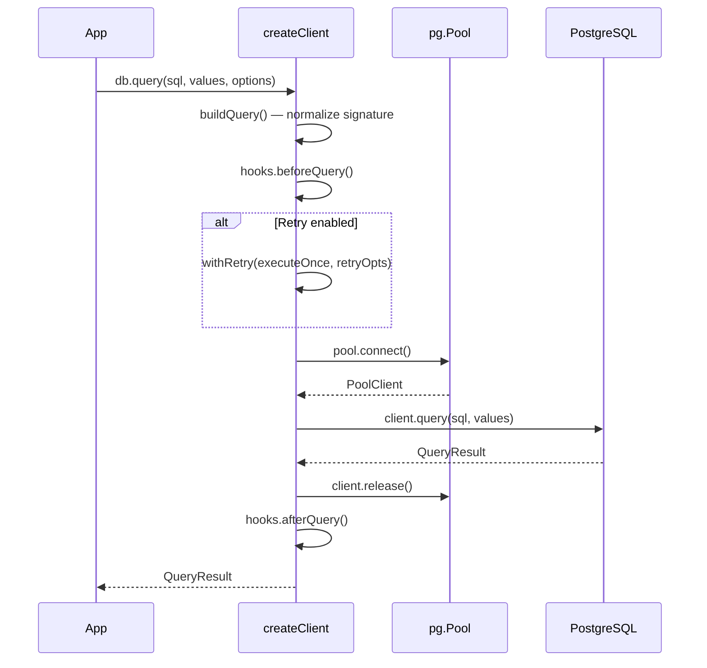
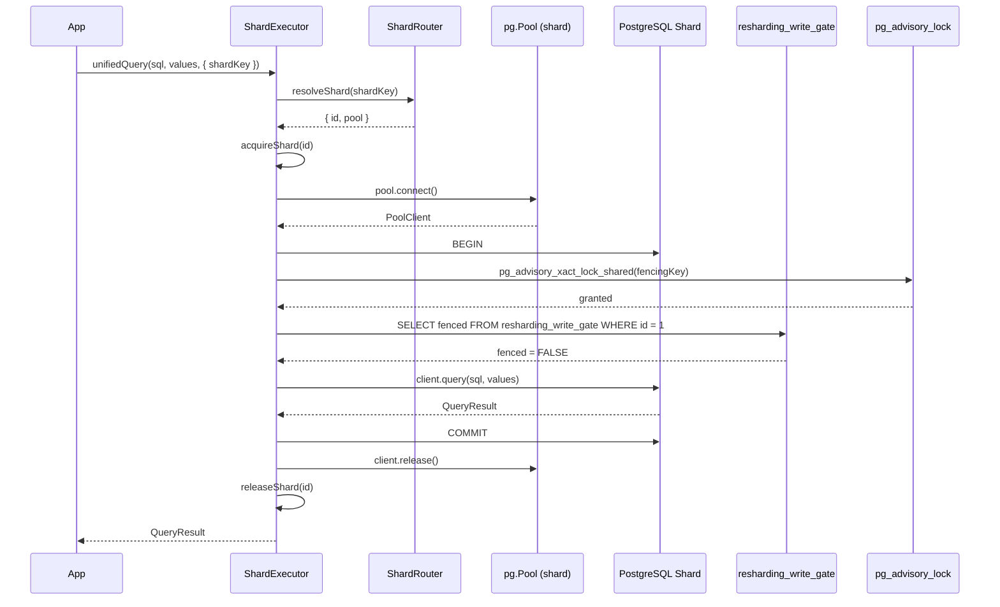
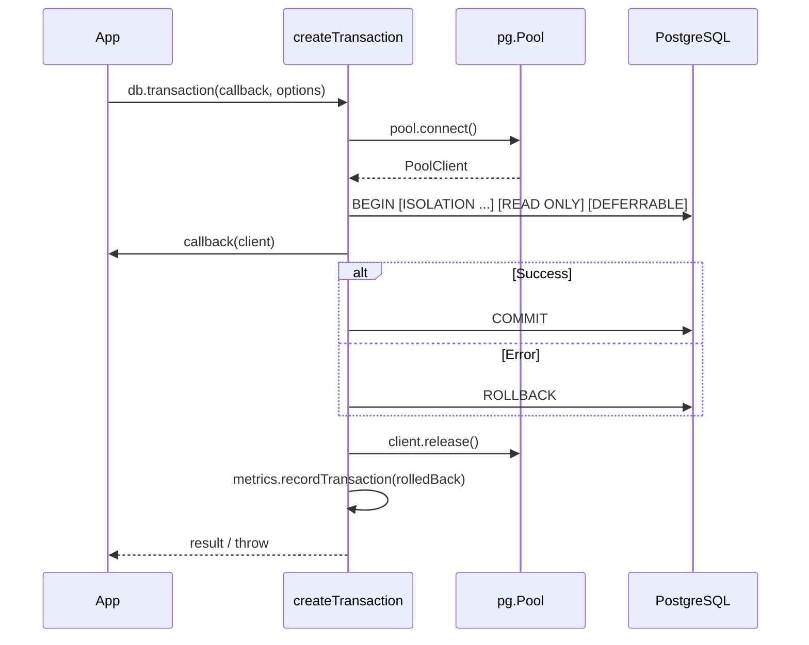
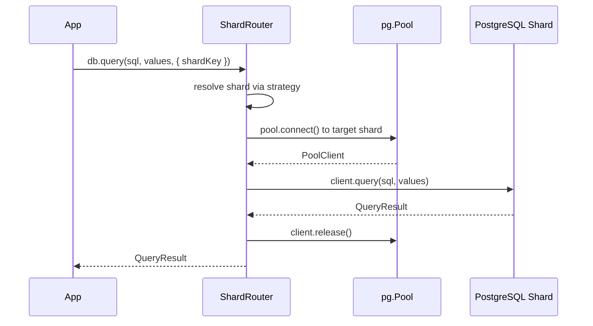
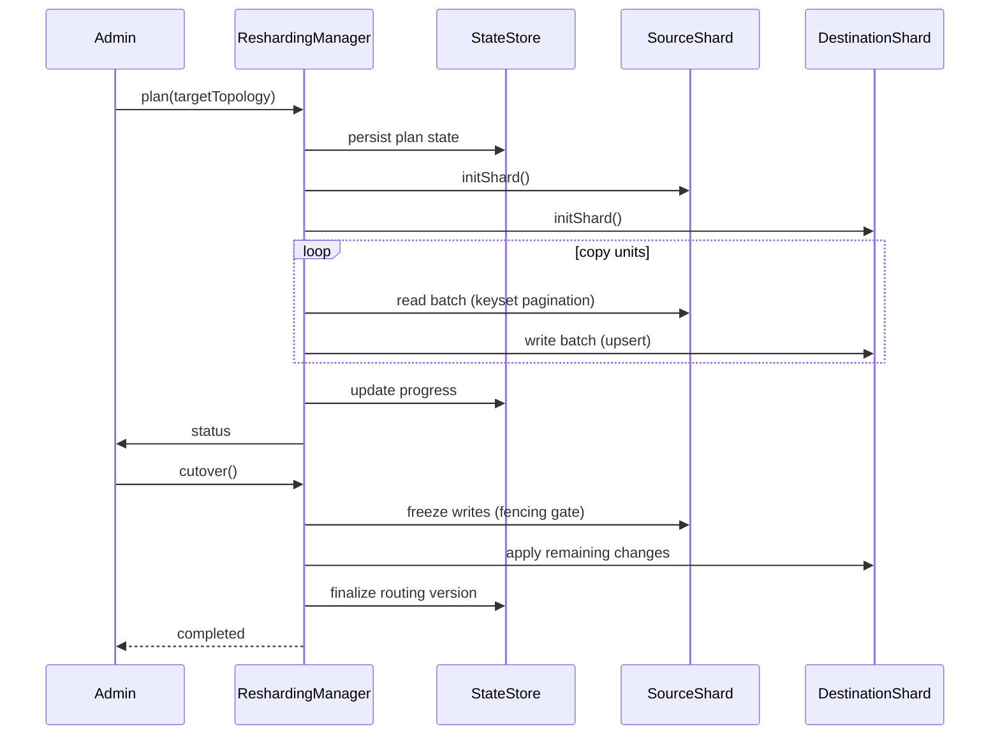
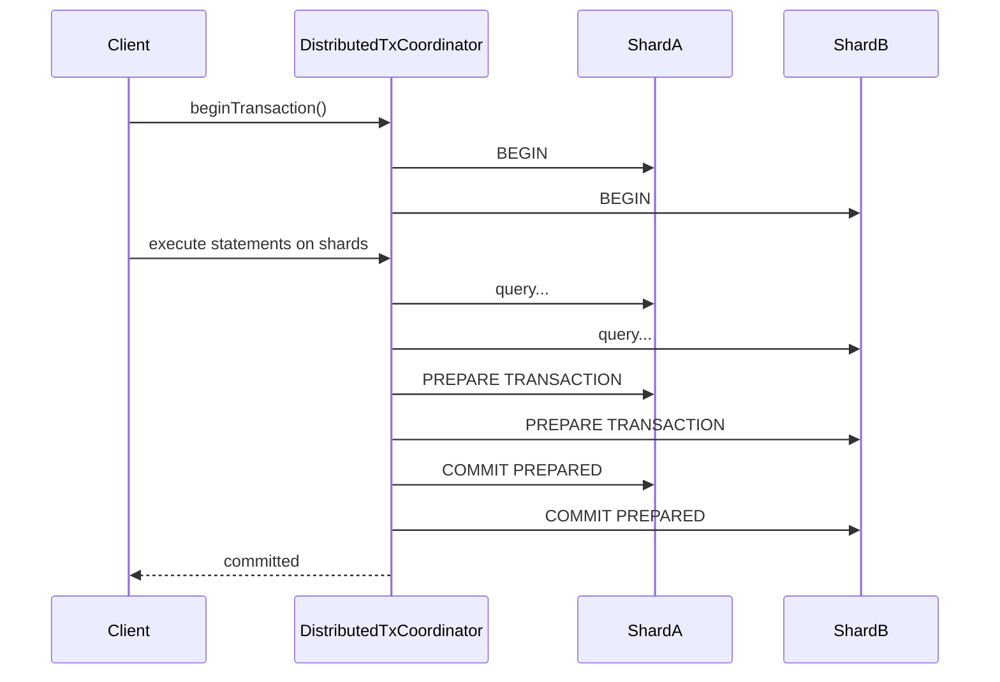
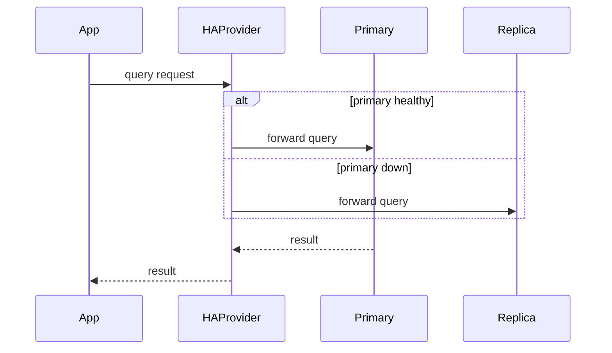
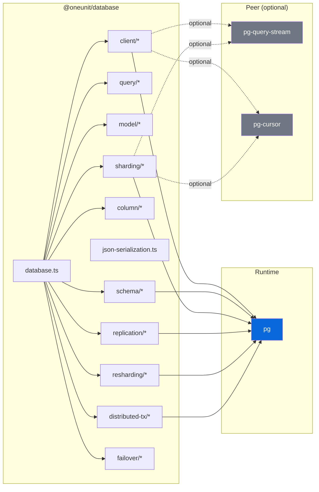

# Architecture

> Internal design reference for `@oneunit/database`. For usage, see [README.md](README.md).

---

## Table of Contents

- [Project Layout](#project-layout)
- [Design Principles](#design-principles)
- [Composition Model](#composition-model)
- [Module Map](#module-map)
- [Core Client Layer](#core-client-layer)
- [Query Layer](#query-layer)
- [Model Layer](#model-layer)
- [Schema & Migration Layer](#schema--migration-layer)
- [Sharding Layer](#sharding-layer)
- [Replication Layer](#replication-layer)
- [Online Resharding Layer](#online-resharding-layer)
- [Distributed Transaction Layer](#distributed-transaction-layer)
- [Failover Layer](#failover-layer)
- [Data Flow Diagrams](#data-flow-diagrams)
- [Key Interfaces](#key-interfaces)
- [Error Architecture](#error-architecture)
- [Instrumentation & Metrics](#instrumentation--metrics)
- [Dependency Graph](#dependency-graph)
- [Testing Strategy](#testing-strategy)
- [Verification Checklist](#verification-checklist)
- [Publishing Checklist](#publishing-checklist)

---

## Project Layout

```
src/
├── index.ts                    # Public barrel — re-exports every public API
├── database.ts                 # createDatabase() — composes all subsystems
├── types.ts                    # All TypeScript interfaces and type declarations
├── json-serialization.ts       # JSON encode/decode, row/result serialization
├── pg-cursor.d.ts              # Ambient type shim for pg-cursor
│
├── client/                     # Connection & execution layer
│   ├── index.ts                # Barrel
│   ├── pool.ts                 # createPool() — pg.Pool from env+overrides
│   ├── config.ts               # loadDatabaseConfig(), parseSslConfig()
│   ├── client.ts               # createClient() — query, queryOne, prepare, retry
│   ├── transaction.ts          # createTransaction() — BEGIN/COMMIT/ROLLBACK
│   ├── batch.ts                # createBatch() — chunked multi-row INSERT
│   ├── stream.ts               # createStream() — pg-query-stream wrapper
│   ├── cursor.ts               # createCursor() — pg-cursor wrapper
│   ├── check.ts                # createCheck() — health & readiness
│   ├── shutdown.ts             # createShutdown() — idempotent pool close
│   ├── retry.ts                # createRetry(), withRetry()
│   ├── errors.ts               # normalizeError(), DatabaseError, classifiers
│   └── hooks.ts                # createHooks(), createMetrics()
│
├── query/                      # SQL construction layer
│   ├── index.ts                # Barrel
│   ├── sql.ts                  # sql`` tagged template, raw, identifier, join
│   └── builder.ts              # QueryBuilder — fluent SELECT/INSERT/UPDATE/DELETE
│
├── model/                      # Table abstraction layer
│   ├── index.ts                # Barrel
│   └── model.ts                # createModel(), createModelFactory()
│
├── schema/                     # DDL & migration layer
│   ├── index.ts                # Barrel
│   ├── schema.ts               # createSchemaManager() — facade
│   ├── create.ts               # CREATE TABLE, CREATE INDEX
│   ├── alter.ts                # ALTER TABLE (add/drop/rename/alter columns)
│   ├── drop.ts                 # DROP TABLE, DROP INDEX
│   ├── constrain.ts            # UNIQUE, FOREIGN KEY, CHECK constraints
│   └── migrate.ts              # createMigrator() — versioned migration runner
│
├── column/                     # Column definition helpers
│   ├── index.ts                # Barrel
│   ├── id.ts                   # id(), bigIntId(), uuid()
│   └── timestamp.ts            # timestamp(...names)
│
├── sharding/                   # Multi-shard routing & execution
│   ├── index.ts                # Barrel + strategy exports
│   ├── shard-manager.ts        # ShardManager — pool lifecycle, drain state
│   ├── shard-router.ts         # ShardRouter — strategy dispatch, shard resolution
│   ├── shard-executor.ts       # ShardExecutor — routing + per-pool client cache
│   ├── shard-health.ts         # ShardHealth — per-shard health checks
│   ├── shard-metrics.ts        # ShardMetrics — per-shard counters
│   ├── shard-migration.ts      # ShardMigrationTracker — cross-shard migration status
│   ├── shard-execution-context.ts — ShardExecutionContext + OperationType
│   ├── strategies.ts           # All 9 shard strategy implementations
│   ├── errors.ts               # ShardNotFoundError, ShardConfigError, etc.
│
├── replication/                # Primary / read-replica routing
│   ├── index.ts                # Barrel
│   ├── replication-manager.ts  # ReplicationManager — pools, health, lag
│   ├── replication-router.ts   # ReplicationRouter — read endpoint selection
│   └── errors.ts               # ReplicationConfigError, ReplicaUnavailableError, etc.
│
├── resharding/                 # Online data migration (durable lifecycle)
│   ├── index.ts                # (if barrel exists)
│   ├── resharding-manager.ts   # ReshardingManager — plan/start/validate/cutover/finalize
│   ├── resharding-store.ts     # Durable state on coordination DB
│   ├── resharding-planner.ts   # planResharding() — unit generation
│   ├── resharding-copier.ts    # keyset-paginated batch copy
│   ├── resharding-cutover.ts   # coordinated cutover (drain, fence, publish)
│   ├── resharding-change-capture.ts — transactional outlog (resharding_changes)
│   ├── resharding-schema.ts    # schema versioning + gate table
│   ├── resharding-types.ts     # MigrationDescriptor, ReshardingApi, etc.
│   └── resharding-errors.ts    # ReshardingError, UnsupportedStrategyError, etc.
│
├── distributed-tx/             # Cross-shard two-phase commit
│   ├── index.ts                # Barrel
│   ├── distributed-transaction-coordinator.ts — coordinator lifecycle
│   ├── distributed-transaction-context.ts — per-shard execution context
│   └── coordinator-schema.ts   # coordination tables for prepared txns
│
└── failover/                   # High-availability provider & state machine
    ├── index.ts                # Barrel
    ├── failover-manager.ts     # FailoverManager — failover control
    ├── ha-provider.ts          # HAProvider — primary/replica switching
    ├── failover-state-machine.ts — ACTIVE/DRAINING/DRAINED/REMOVED states
    └── errors.ts               # Failover errors
```

---

## Design Principles

### 1. Composition over Inheritance

`createDatabase()` composes independent factory functions. Each subsystem (`client`, `transaction`, `schema`, `model`, `sharding`, `replication`, `resharding`, `distributed-tx`, `failover`) is a standalone unit that receives only its explicit dependencies. There are no base classes, no `this` binding, and no hidden shared state.

### 2. Explicit Configuration

Configuration flows through a strict precedence chain:

```
environment variables → alias fallbacks → hard-coded defaults → explicit overrides
```

`loadDatabaseConfig()` is the single source of truth. Credentials never appear in logs (the `sanitizeConnectionForLogging()` helper strips CA certificates and passwords).

### 3. Parameterized SQL Everywhere

All user values flow through `$1, $2, …` placeholders. The `sql` tagged template and `QueryBuilder` both enforce this — identifiers are quoted, values are never interpolated into SQL text.

### 4. Opt-in Retries

Retries are **off by default**. When enabled, only genuinely transient PostgreSQL errors are retried: serialization failures (`40001`), deadlocks (`40P01`), and connection-level errors. Non-idempotent writes should never use retries.

### 5. Idempotent Lifecycle

- `shutdown()` — safe to call multiple times; concurrent callers share one in-flight close
- `migrate.run()` — skips already-applied migrations under an advisory lock
- Pool creation is lazy — no connection is opened until the first query
- Resharding operations (`plan`, `start`, `pause`, `resume`, `cancel`, `validate`, `cutover`, `finalize`) are all durable and idempotent

### 6. Atomic Write Fencing

When an online resharding migration is active, writes to shards being migrated are protected by a shared advisory lock (`pg_advisory_xact_lock_shared`) acquired before checking the durable write gate table (`resharding_write_gate`). Cutover acquires an exclusive lock, which blocks until all shared-lock holders finish — eliminating TOCTOU races.

---

## Composition Model

`createDatabase()` assembles the public `Database` object from independent factories:

```mermaid
graph TD
    CD["createDatabase(options)"]

    CD --> CP["createPool()"]
    CD --> CC["createClient(pool)"]
    CD --> CT["createTransaction(pool)"]
    CD --> CS["createStream(pool)"]
    CD --> CU["createCursor(pool)"]
    CD --> CK["createCheck(pool)"]
    CD --> SD["createShutdown(pool)"]
    CD --> CB["createBatch(query, tx)"]
    CD --> QB["createQueryBuilder(query)"]
    CD --> MF["createModelFactory(query)"]
    CD --> SM["createSchemaManager(pool)"]
    CD --> MG["createMigrator(pool)"]
    CD --> CH["createHooks(options)"]
    CD --> CR["createRetry(defaults)"]
    CD --> SH["ShardManager"]
    CD --> SR["ShardRouter"]
    CD --> SE["ShardExecutor"]
    CD --> RC["ReplicationManager"]
    CD --> RM["ReshardingManager"]
    CD --> DT["DistributedTransactionCoordinator"]

    CC -.->|query, queryOne, prepare| DB["Database"]
    CT -.->|transaction, savepoint| DB
    CS -.->|stream| DB
    CU -.->|cursor| DB
    CK -.->|check, health| DB
    SD -.->|shutdown| DB
    CB -.->|batch| DB
    QB -.->|from, table| DB
    MF -.->|model| DB
    SM -.->|schema| DB
    MG -.->|migrate| DB
    CH -.->|hooks, metrics| DB
    CR -.->|retry| DB
    SH -.->|shards| DB
    SR -.->|route| DB
    SE -.->|execute| DB
    RC -.->|replicate| DB
    RM -.->|reshard| DB
    DT -.->|distributed-tx| DB

    style CD fill:#0969da,color:#fff
    style DB fill:#22863a,color:#fff
```



Each factory receives only the dependencies it needs (pool, query function, logger). No factory has access to the full `Database` object.

---

## Module Map

### client/

| File | Factory | Produces | Key Dependencies |
| :--- | :--- | :--- | :--- |
| `pool.ts` | `createPool()` | `pg.Pool` | `pg`, config |
| `config.ts` | `loadDatabaseConfig()` | `DatabaseConfig` | `process.env` |
| `client.ts` | `createClient()` | `query`, `queryOne`, `prepare`, `prepared` | pool, hooks, retry |
| `transaction.ts` | `createTransaction()` | `transaction`, `savepoint` | pool, hooks, retry |
| `batch.ts` | `createBatch()` | `batch.insertMany` | query, transaction |
| `stream.ts` | `createStream()` | `stream` | pool, `pg-query-stream` |
| `cursor.ts` | `createCursor()` | `cursor` | pool, `pg-cursor` |
| `check.ts` | `createCheck()` | `check`, `health` | pool |
| `shutdown.ts` | `createShutdown()` | `shutdown` | pool |
| `retry.ts` | `createRetry()`, `withRetry()` | `RetryApi` | error classifiers |
| `errors.ts` | `normalizeError()` | `DatabaseError`, classifiers | — |
| `hooks.ts` | `createHooks()`, `createMetrics()` | `QueryHooks`, `MetricsCollector` | logger, instrumentation config |

### sharding/

| File | Factory / Class | Produces | Key Dependencies |
| :--- | :--- | :--- | :--- |
| `shard-manager.ts` | `ShardManager` | pool lifecycle, drain state | pg.Pool, config |
| `shard-router.ts` | `ShardRouter` | shard resolution via strategy | ShardManager, strategy |
| `shard-executor.ts` | `ShardExecutor` | routing + per-pool client cache | ShardManager, ShardRouter |
| `shard-health.ts` | `ShardHealth` | per-shard health checks | ShardManager, createCheck |
| `shard-metrics.ts` | `createShardMetrics()` | per-shard counters | hooks |
| `shard-migration.ts` | `ShardMigrationTracker` | cross-shard migration status | ShardManager |
| `strategies.ts` | `createShardStrategy()` | strategy instances | — |
| `errors.ts` | error classes | Shard errors | — |

### replication/

| File | Factory / Class | Produces | Key Dependencies |
| :--- | :--- | :--- | :--- |
| `replication-manager.ts` | `ReplicationManager` | pools, health, lag | pg.Pool, config |
| `replication-router.ts` | `ReplicationRouter` | read endpoint selection | health states |
| `errors.ts` | error classes | Replication errors | — |

### resharding/

| File | Factory / Class | Produces | Key Dependencies |
| :--- | :--- | :--- | :--- |
| `resharding-manager.ts` | `ReshardingManager` | plan/start/validate/cutover/finalize | coordination pool, ShardManager |
| `resharding-store.ts` | `ReshardingStore` | durable migration state | coordination pool |
| `resharding-planner.ts` | `planResharding()` | migration units | topology snapshots |
| `resharding-copier.ts` | `ReshardingCopier` | keyset-paginated batch copy | source + dest pools |
| `resharding-cutover.ts` | `ReshardingCutover` | coordinated cutover | store, change capture |
| `resharding-change-capture.ts` | `ReshardingChangeCapture` | transactional outlog | shard pools |
| `resharding-schema.ts` | `createReshardingSchema()` | schema versioning, gate table | — |
| `resharding-types.ts` | types | MigrationDescriptor, ReshardingApi | — |
| `resharding-errors.ts` | error classes | Resharding errors | — |

### distributed-tx/

| File | Factory / Class | Produces | Key Dependencies |
| :--- | :--- | :--- | :--- |
| `distributed-transaction-coordinator.ts` | `DistributedTransactionCoordinator` | 2PC lifecycle | coordination pool |
| `distributed-transaction-context.ts` | `DistributedTransactionContext` | per-shard execution | shard pools |
| `coordinator-schema.ts` | schema | coordination tables | — |

### failover/

| File | Factory / Class | Produces | Key Dependencies |
| :--- | :--- | :--- | :--- |
| `failover-manager.ts` | `FailoverManager` | failover control | — |
| `ha-provider.ts` | `HAProvider` | primary/replica switching | replication topology |
| `failover-state-machine.ts` | state machine | ACTIVE/DRAINING/DRAINED/REMOVED | — |
| `errors.ts` | error classes | Failover errors | — |

### model/

| File | Factory | Produces |
| :--- | :--- | :--- |
| `model.ts` | `createModelFactory()` → `createModel()` | `Model` with CRUD methods |

Model methods: `find`, `findOne`, `findById`, `insert`, `insertMany`, `update`, `updateById`, `delete`, `deleteById`, `remove`, `removeById`, `count`, `exists`. Each accepts an optional `{ client }` for transactional use.

### schema/

| File | Factory | Produces |
| :--- | :--- | :--- |
| `schema.ts` | `createSchemaManager()` | `SchemaManager` facade |
| `create.ts` | — | `schema.create.table()`, `schema.create.index()` |
| `alter.ts` | — | `schema.alter.addColumns()`, `dropColumns()`, `renameColumn()`, `alterColumn()`, `renameTable()`, `unique()` |
| `drop.ts` | — | `schema.drop.table()`, `schema.drop.index()` |
| `constrain.ts` | — | `schema.constrain.unique()`, `foreignKey()`, `check()`, `dropConstraint()` |
| `migrate.ts` | `createMigrator()` | `migrate.run()`, `migrate.status()`, `migrate.rollback()` |

Migrations run under a PostgreSQL advisory lock. Each migration gets its own transaction. The migrations table is auto-created on first run.

### column/

| File | Exports |
| :--- | :--- |
| `id.ts` | `id()` → UUID PK, `bigIntId()` → BIGSERIAL PK, `uuid()` → UUID column |
| `timestamp.ts` | `timestamp(...names)` → TIMESTAMPTZ columns with `DEFAULT NOW()` |

### json-serialization

Standalone utilities for encoding/decoding rows and query results as JSON buffers:

`encode`, `decode`, `encodeToString`, `decodeFromString`, `serializeRow`, `deserializeRow`, `serializeQueryResult`, `deserializeQueryResult`

---

## Core Client Layer

### Connection Pooling (`client/pool.ts`)

`createPool()` merges explicit options with `loadDatabaseConfig()` (environment + aliases + defaults) and constructs a `pg.Pool`. It attaches event listeners for `connect`, `acquire`, `remove`, and `error` — logging connection lifecycle events without recording credentials. If `idleTransactionTimeout` is enabled, PostgreSQL's `idle_in_transaction_session_timeout` startup parameter is applied to every new physical connection.

### Query Client (`client/client.ts`)

`createClient()` normalizes all supported call shapes into a single `pg` `QueryConfig`:

- `query(sql, values, options)`
- `query({ text, values }, options)`
- `query({ name, text, values }, options)`
- `query(QueryInstance, options)`

The client wraps each execution in `executeOnce()` which:
1. Acquires a connection from the pool (with optional connect timeout)
2. Calls `hooks.beforeQuery(context)` to record start time and log the query
3. Executes the query via `runQuery()`, which enforces a per-query execution timeout
4. Calls `hooks.afterQuery(context)` on success, recording duration and row count
5. Calls `hooks.onQueryError(context, error)` on failure, recording the error
6. Releases the connection back to the pool (destroying it if a connection error occurred)

Retry logic is opt-in via `withRetry()`, which only retries errors classified as transient by `isTransientError()`.

### Configuration (`client/config.ts`)

`loadDatabaseConfig()` is the single source of truth for all environment access. Supported variables include `DATABASE_URL`, `DATABASE_HOST`, `DATABASE_PORT`, `DATABASE_NAME`, `DATABASE_USER`, `DATABASE_PASSWORD`, `DATABASE_POOL_MAX` (default `20`), `DATABASE_POOL_MIN` (default `0`), `DATABASE_CONNECTION_TIMEOUT` (default `5000`), `DATABASE_IDLE_TIMEOUT` (default `30000`), `DATABASE_QUERY_TIMEOUT`, `DATABASE_STATEMENT_TIMEOUT`, `DATABASE_SSL`, `DATABASE_SSL_CA`, and `DATABASE_APP_NAME`. Aliases (`PGHOST`, `PGPORT`, `PGDATABASE`, `PGUSER`, `PGPASSWORD`, `DB_MAX_CONN`, `DB_POOL_SIZE`, `DB_MIN_CONN`, `DB_CONN_TIMEOUT`, `DB_IDLE_TIMEOUT`) are checked as fallbacks.

### Hooks & Metrics (`client/hooks.ts`)

`createHooks()` builds the instrumentation surface. Parameter values are never logged unless `logParameters: true`. Query text is only logged when `logQueries: true`. The `MetricsCollector` tracks in-memory, allocation-free counters: `queries`, `errors`, `slowQueries`, `retries`, `transactions`, `rolledBackTransactions`, `totalDurationMs`, `maxDurationMs`, `lastDurationMs`.

### Retry (`client/retry.ts`)

`withRetry()` implements exponential backoff with jitter: `delay = base * factor^attempt`, capped at `maxDelay`, with `jitter` spread. It only retries when `shouldRetry(error)` returns true (default: `isTransientError()`). An `AbortSignal` can cancel the retry loop.

### Errors (`client/errors.ts`)

`normalizeError()` maps raw PostgreSQL error codes to structured `DatabaseError` instances with `.code`, `.detail`, `.hint`, `.constraint`, `.table`, `.column`, `.schema`, `.dataType`, `.severity`, `.position`, `.where`, `.routine`, `.sqlState`, `.transient`, and `.cause`. Classification helpers include `isUniqueViolation` (`23505`), `isForeignKeyViolation` (`23503`), `isNotNullViolation` (`23502`), `isCheckViolation` (`23514`), `isExclusionViolation` (`23P01`), `isSerializationFailure` (`40001`), `isDeadlock` (`40P01`), `isConnectionError`, `isConstraintViolation` (`23xxx`), and `isTransientError`.

---

## Query Layer

### SQL Tagged Template (`query/sql.ts`)

The `sql` tagged template produces a `SqlFragment` with `.text` and `.values`. Helpers include `sql.raw()`, `sql.identifier()`, `sql.quoteIdent()`, `sql.join()`, and `sql.isFragment()`. All interpolated values are appended to `.values` and sent as `$1, $2, …` parameters — never interpolated into the SQL text.

### Query Builder (`query/builder.ts`)

`createQueryBuilder()` returns a fluent, thenable `QueryBuilder`. Supported methods: `select`, `distinct`, `insert`, `values`, `update`, `delete`, `returning`, `where`, `orWhere`, `whereNull`, `whereNotNull`, `whereIn`, `whereRaw`, `join`, `leftJoin`, `groupBy`, `having`, `orderBy`, `limit`, `offset`, `onConflict`, `toSQL`, `execute`, `first`, and `then`. Shard pinning is available via `withShard(shardKey)` and `withShardId(shardId)`. The builder implements `.then()` so `await db.from("users").select()` works without calling `.execute()`.

---

## Model Layer

### Model (`model/model.ts`)

`createModelFactory()` → `createModel(table, { idColumn })` produces a `Model` with table-level CRUD abstraction:

- `find(where?, options?)` → `QueryResultRow[]`
- `findOne(where?, options?)` → `QueryResultRow | null`
- `findById(id, options?)` → `QueryResultRow | null`
- `insert(data, options?)` → `QueryResultRow | null`
- `insertMany(rows, options?)` → `QueryResultRow[]`
- `update(where, data, options?)` → `QueryResultRow[]`
- `updateById(id, data, options?)` → `QueryResultRow | null`
- `delete(where, options?)` → `QueryResultRow[]`
- `deleteById(id, options?)` → `QueryResultRow | null`
- `remove(where, options?)` → `QueryResultRow[]`
- `removeById(id, options?)` → `QueryResultRow | null`
- `count(where?, options?)` → `number`
- `exists(where?, options?)` → `boolean`

Each method accepts an optional `{ client }` to run inside an existing transaction.

---

## Schema & Migration Layer

### Schema Manager (`schema/schema.ts`)

`createSchemaManager()` returns a facade with `create`, `alter`, `drop`, and `constrain` namespaces:

- `create.table(name, columns)`, `create.index(name, table, columns)`
- `alter.addColumns()`, `dropColumns()`, `renameColumn()`, `alterColumn()`, `renameTable()`, `unique()`
- `drop.table()`, `drop.index()`
- `constrain.unique()`, `foreignKey()`, `check()`, `dropConstraint()`

### Migrator (`schema/migrate.ts`)

`createMigrator()` runs versioned migrations under a PostgreSQL advisory lock:

1. Acquire `pg_advisory_lock(lockKey)`
2. `CREATE TABLE IF NOT EXISTS _migrations`
3. Load migrations from directory or inline array (loaded in filename order)
4. Filter out already-applied migrations (by id)
5. For each pending migration: `BEGIN`, execute up (SQL string or async function), `INSERT INTO _migrations`, `COMMIT`
6. Release advisory lock

Each migration runs inside its own transaction. The migrations table is auto-created on first run.

---

## Sharding Layer

### Overview

Sharding routes queries to different PostgreSQL databases (shards) based on a shard key. Each shard is an independent database with its own connection pool. Nine routing strategies are available:

| Strategy | Name | Best For | Key Characteristic |
| :--- | :--- | :--- | :--- |
| Hash | `hash` | General purpose | Deterministic modulo; remaps most keys when shard count changes |
| Consistent Hash | `consistent-hash` | Cache-like workloads | Ring with virtual nodes; minimal remapping on membership change |
| Rendezvous | `rendezvous` | General purpose | Highest random weight; deterministic ranking per key |
| Range | `range` | Ordered keys | Explicit numeric/string ranges; no silent fallback |
| Directory | `directory` | Known key→shard mapping | Exact lookup; configurable unknown-key policy |
| Tenant | `tenant` | Multi-tenant SaaS | Tenant ID → shard mapping; optional default shard |
| Composite | `composite` | Multi-component keys | Length-prefixed serialization to prevent collisions |
| Geographic | `geographic` | Data residency | Region → eligible shards; deterministic selection |
| Weighted | `weighted` | Uneven capacity | Weighted highest-random-weight |

### ShardManager (`sharding/shard-manager.ts`)

Manages per-shard `pg.Pool` instances, lifecycle state (`ACTIVE`/`DRAINING`/`DRAINED`/`REMOVED`), health state, and distributed drain coordination:

- **Pool creation**: One pool per shard config, created eagerly at construction
- **Shard lifecycle**: Tracks active operations (`activeOps`), registered operation IDs, and drain state
- **Distributed drain**: Uses `shard_drain_state` and `shard_active_ops` tables on a coordination database (or first shard pool). `acquireShard()` atomically registers an operation with `INSERT ... WHERE NOT EXISTS (draining = TRUE)`, preventing TOCTOU races
- **addShard() / removeShard()**: Serialized via mutex, bumps `routingVersion`, runs `onBeforeReshard`/`onAfterReshard` hooks. `removeShard()` marks draining, waits for active operations to complete (up to `abandonedOperationTimeoutMs`, default 5 min), then closes the pool
- **Coordination modes**: `strict` (requires coordination DB), `local-only` (local state only), `fail-closed` (rejects when coordination unavailable)

### ShardRouter (`sharding/shard-router.ts`)

Dispatches shard key resolution to the configured strategy:

- `resolveShardId(shardKey)` → shard ID via `strategy.resolveShard()`
- `resolveShard(shardKey)` → `{ id, pool }`
- `resolveDefaultShard()` → default shard if configured
- `validateStrategyConfig()` → delegates to strategy's `validate()`

### ShardExecutor (`sharding/shard-executor.ts`)

Single source of truth for shard routing resolution and per-pool client caching:

- `resolve(options)` → `{ context, pool, shardId }` — resolves via shardId, shardKey, or falls back to primary pool
- `getClientForPool(pool)` — caches one client per pool, reused across queries
- `acquireShard()` / `releaseShard()` — distributed drain tracking
- `withClient()` — executes a callback with a dedicated connection from the resolved pool

### ShardHealth (`sharding/shard-health.ts`)

Per-shard health checking with connectivity, readiness, and replication dimensions:

- Connectivity: `SELECT 1` succeeds → `healthy`
- Readiness: shard in `ACTIVE` state and connectivity healthy → `ready`
- Reports `status` (`up`/`down`), `latency`, pool stats (`total`, `idle`, `waiting`), error, code, `consecutiveFailures`, and `checkedAt`
- Health checks never throw — down shards are reported in the result

### Shard Strategies (`sharding/strategies.ts`)

All strategies implement `ShardStrategy` with `validate()` and `resolveShard()`:

- `HashShardStrategy` — FNV-1a 32-bit hash modulo shard count
- `ConsistentHashShardStrategy` — hash ring with virtual nodes
- `RendezvousShardStrategy` — highest random weight ranking
- `RangeShardStrategy` — explicit range boundaries
- `DirectoryShardStrategy` — exact key→shard lookup
- `TenantShardStrategy` — tenant ID → shard mapping
- `CompositeShardStrategy` — length-prefixed composite key serialization
- `GeographicShardStrategy` — region → eligible shards
- `WeightedShardStrategy` — weighted highest-random-weight

Custom strategies can be implemented directly (no global registry for user-defined strategies).

### Sharding API (`database.ts` → `buildShardingApi()`)

The `db.sharding` surface exposes:

- `enabled`, `strategy`, `routingVersion`, `shards`
- `getShard(id)`, `getShardForKey(key)`
- `query(shardKey, text, values, options)` — deprecated compatibility wrapper
- `transaction(shardKey, callback, options)` — deprecated compatibility wrapper
- `distributedTransaction(callback, options)` — two-phase commit across shards
- `shutdown()`, `health()`, `shardHealth(id)`
- `addShard(config, hooks)`, `removeShard(id, hooks)`
- `batchInsertMany(groups)` — per-shard batch inserts
- `fanOut({ query, values, shardIds, concurrency, merge, onShardError })` — parallel execution across shards
- `queryAllShards({ query, values, concurrency, merge })` — convenience wrapper
- `topology` — `snapshot()`, `validate()`, `planRebalance()`
- `metrics` — per-shard counters and routing observability
- `executeOnShard(id, callback)` — dedicated connection for DDL/admin
- `distributedTx` — coordinator instance
- `isClosed`

### Write Fencing

When an online resharding migration is active, sharded writes acquire a shared advisory lock (`pg_advisory_xact_lock_shared`) before checking the durable `resharding_write_gate` table. If `fenced = TRUE`, the write is rejected with `WriteFencedError`. Cutover acquires an exclusive lock, blocking until all shared-lock holders finish.

---

## Replication Layer

### Overview

Replication routes queries between one PostgreSQL primary and zero or more read replicas. The package configures **client connections** to those replicas — it does not create, promote, or fail over replicas. Routing is driven entirely by an explicit `readPreference` on query options — **never** by parsing SQL.

### ReplicationManager (`replication/replication-manager.ts`)

Manages one primary pool plus zero or more replica pools:

- Primary pool may be supplied externally (owned by `ShardManager` for sharded DBs) or created internally
- Replica pools are created and owned by the manager
- `readEndpoint(readPreference)` → endpoint for reads based on mode:
  - `"primary"` → always primary
  - `"replica-preferred"` → eligible replica, fall back to primary
  - `"replica-only"` → replica only; `null` if none eligible
- `writeEndpoint()` → always primary; throws `WriteToReplicaError` if routed to replica
- Health checks measure connectivity and replication lag (`pg_last_xact_replay_timestamp()`)
- `lagThresholdMs` excludes replicas whose known lag exceeds the threshold
- `addReplica()` / `removeReplica()` — runtime topology changes with drain-and-wait

### ReplicationRouter (`replication/replication-router.ts`)

Selects read endpoints based on `readPreference` and endpoint health/lag state. Rebuilt whenever health state changes (`syncRouter()`).

### Replication API (`database.ts` → `buildReplicationApi()`)

The `db.replication` surface exposes:

- `enabled`, `mode`, `primaryEndpointId`, `replicaEndpointIds`
- `health()`, `endpointHealth(id)`
- `primaryPool` — bypasses router for writes/admin
- `readEndpoint(preference)` — or `null` if none eligible
- `shutdown()`, `isClosed`

---

## Online Resharding Layer

### Overview

`@oneunit/database` includes a durable, crash-recoverable online resharding subsystem that redistributes existing records when shard membership or routing configuration changes. The coordination authority is a single PostgreSQL database (the `coordination` pool) that owns migration lifecycle state, units, checkpoints, change-log offsets, and published routing versions.

### ReshardingManager (`resharding/resharding-manager.ts`)

Enforces legal state transitions with optimistic concurrency control (version column) plus an advisory worker lock:

```
planned → copying → catching_up → validating → ready_for_cutover → cutting_over → completed → finalized
```

Operator-visible states: `paused`, `failed`, `cancelled`, `rollback_required`.

### Lifecycle Operations

| Operation | Description |
| :--- | :--- |
| `plan(descriptor, targetTopology)` | Captures source topology snapshot, generates migration units, persists plan |
| `start()` | Claims worker lock, transitions `planned` → `copying` |
| `pause()` | Transitions copying/catching_up/validating/ready_for_cutover → `paused` |
| `resume()` | Reclaims worker lock, transitions `paused` → `copying` |
| `cancel()` | Releases worker lock, transitions to `cancelled`, unfences writes |
| `validate(descriptor?)` | Replays change-log to consistency boundary, validates destination |
| `cutover()` | Verifies copy complete, drains change log, fences writes, publishes routing version atomically |
| `finalize()` | Transitions `completed` → `finalized`, releases worker lock |
| `getStatus()` | Returns durable migration status |
| `instrumentedTransaction(shardId, callback)` | Executes mutation + CDC capture atomically in one transaction |
| `isShardWriteFenced(id)` | Durable fence check (fail-closed if unverifiable) |

### Key Guarantees

- **Durable state**: Migration lifecycle, per-unit checkpoints, change-log offsets, and routing versions persisted on coordination database (versioned schema, idempotent init)
- **Bounded, resumable copy**: Keyset-paginated batches (never offset pagination), configurable batch size/concurrency/throttle/retries. Checkpoints advance only after destination write commits
- **Idempotent destination writes**: Adapters use upsert (`ON CONFLICT`) semantics; repeated delivery does not duplicate logical records
- **Change capture**: Transactional outlog (`resharding_changes`) records source mutations atomically with the source mutation, with stable sequence ordering
- **Coordinated cutover**: Verifies copy complete, drains change log to consistency boundary, fences writes for moved keys, publishes new routing version atomically. Writes briefly paused during drain/fence window
- **Crash recovery**: All operations durable and idempotent; restart during cutover inspects durable state to roll forward or require operator intervention

### ReshardingStore

Durable state layer on the coordination database. Tables include migration records, units, checkpoints, write gates, and routing versions. Uses advisory locks for schema initialization.

### ReshardingCopier

Keyset-paginated batch copy with configurable batch size, concurrency, throttle, retries, and timeouts. Validates counts, duplicates, checksums, and destination placement.

### ReshardingChangeCapture

Transactional outlog pattern. `recordChange(client, event)` writes change events through the same client as the source mutation, so they commit or roll back together.

### ReshardingCutover

Coordinated cutover: acquire write barrier (exclusive advisory lock), drain change log to consistency boundary, fence writes, publish routing version atomically.

---

## Distributed Transaction Layer

### Overview

Cross-shard two-phase commit (2PC) coordinator. Requires `max_prepared_transactions > 0` on all participating PostgreSQL servers. Throws `MaxPreparedTransactionsError` if not configured.

### DistributedTransactionCoordinator (`distributed-tx/distributed-transaction-coordinator.ts`)

Manages the 2PC lifecycle:

1. `begin(options)` → transaction ID, registers participant pools
2. `execute(shardKey, text, values, options)` via `DistributedTransactionContext` — runs SQL on specific shard within the transaction
3. `prepare(transactionId)` — Phase 1: PREPARE TRANSACTION on all participants
4. `commit(transactionId)` — Phase 2: COMMIT PREPARED on all participants
5. `abort(transactionId)` — ROLLBACK PREPARED on all participants
6. `getStatus(transactionId)` — durable status inspection

### DistributedTransactionContext

Provides `execute(shardKey, text, values, options)` for running SQL on specific shards within the distributed transaction. All operations are prepared atomically and committed or aborted together.

### Coordination Schema

Durable tables store transaction state, participant lists, and prepared transaction identifiers for crash recovery.

---

## Failover Layer

### Overview

High-availability provider and state machine for managing primary/replica failover. States: `ACTIVE` → `DRAINING` → `DRAINED` → `REMOVED`.

### FailoverManager (`failover/failover-manager.ts`)

Controls failover operations, serializing topology changes via mutex.

### HAProvider (`failover/ha-provider.ts`)

Switches traffic from primary to replica when primary is down. State is not persisted across process restarts.

### FailoverStateMachine (`failover/failover-state-machine.ts`)

Enforces state transitions and tracks active operations for drain-and-wait semantics.

---

## Data Flow Diagrams

### Query Execution (Non-Sharded)



### Query Execution (Sharded, with Write Fencing)



### Transaction Lifecycle



### Savepoints

Savepoints nest inside a transaction — they issue `SAVEPOINT name` / `RELEASE SAVEPOINT name` / `ROLLBACK TO SAVEPOINT name` without touching the outer `BEGIN` / `COMMIT`.

### Batch Insert Pipeline

```
db.batch.insertMany(table, rows, options)
  │
  ├─ inferColumns()        — union of all keys across all rows
  ├─ chunkSize             — min(options.chunkSize, floor(65535 / columns.length))
  │
  ├─ for each chunk:
  │   ├─ build VALUES ($1,$2,...), ($3,$4,...), ...
  │   ├─ append ON CONFLICT clause (if configured)
  │   ├─ append RETURNING clause (if configured)
  │   └─ execute via query()
  │
  └─ return collected results
```

### Migration Runner

```
db.migrate.run({ directory })
  │
  ├─ pg_advisory_lock(lockKey)
  ├─ CREATE TABLE IF NOT EXISTS _migrations
  ├─ load migrations from directory / inline array
  ├─ filter out already-applied (by id)
  │
  ├─ for each pending migration:
  │   ├─ BEGIN
  │   ├─ execute up (SQL string or async function)
  │   ├─ INSERT INTO _migrations
  │   └─ COMMIT
  │
  └─ pg_advisory_unlock(lockKey)
```

### Sharding Execution



### Resharding Lifecycle



### Distributed Transaction Coordination (2PC)



### Failover Handling



---

## Key Interfaces

### `Database` — the public API surface

```typescript
interface Database {
    pool: Pool;

    // Queries
    getClient(options?): Promise<PoolClient>;
    query<T>(text, values?, options?): Promise<QueryResult<T>>;
    queryOne<T>(text, values?, options?): Promise<T | null>;
    releaseClient(client?, error?): void;
    prepare(name, text): PreparedStatement;
    prepared(name, text, values?, options?): Promise<QueryResult>;

    // Transactions
    transaction<T>(callback, options?): Promise<T>;
    savepoint<T>(client, name, callback): Promise<T>;

    // Streaming
    stream(text, values?, options?): Promise<ReadableStream>;
    cursor(text, values?, options?): Promise<CursorHandle>;

    // Health & lifecycle
    check(options?): Promise<HealthCheckResult>;
    health(options?): Promise<HealthResult>;
    shutdown(options?): Promise<void>;

    // Batch
    batch: BatchApi;

    // Query builder
    from(table): QueryBuilder;
    table(table): QueryBuilder;         // alias of `from`

    // Models
    model(table, options?): Model;

    // Schema DDL
    schema: SchemaManager;

    // Migrations
    migrate: Migrator;

    // Instrumentation
    hooks: QueryHooks;
    metrics: MetricsCollector;
    retry: RetryApi;

    // Sharding
    sharding: ShardingApi;

    // Replication
    replication: ReplicationApi;

    // Online resharding (when sharding enabled)
    resharding?: ReshardingApi;
}
```

### `QueryBuilder`

Fluent, thenable query builder. Supports `select`, `distinct`, `insert`, `values`, `update`, `delete`, `returning`, `where`, `orWhere`, `whereNull`, `whereNotNull`, `whereIn`, `whereRaw`, `join`, `leftJoin`, `groupBy`, `having`, `orderBy`, `limit`, `offset`, `onConflict`, `toSQL`, `execute`, `first`, `then`. Shard pinning via `withShard()` / `withShardId()`.

### `Model`

Table-level CRUD abstraction: `find`, `findOne`, `findById`, `insert`, `insertMany`, `update`, `updateById`, `delete`, `deleteById`, `remove`, `removeById`, `count`, `exists`, `query`, `builder`, `select`.

### `SchemaManager`

```typescript
interface SchemaManager {
    create: { table(), index() };
    alter:  { addColumns(), dropColumns(), renameColumn(), alterColumn(), renameTable(), unique() };
    drop:   { table(), index() };
    constrain: { unique(), foreignKey(), check(), dropConstraint() };
}
```

### `ShardingApi`

Exposes `enabled`, `strategy`, `routingVersion`, `shards`, `getShard()`, `getShardForKey()`, `query()`, `transaction()`, `distributedTransaction()`, `shutdown()`, `health()`, `shardHealth()`, `addShard()`, `removeShard()`, `batchInsertMany()`, `fanOut()`, `queryAllShards()`, `topology`, `metrics`, `executeOnShard()`, `distributedTx`, `isClosed`.

### `ReplicationApi`

Exposes `enabled`, `mode`, `primaryEndpointId`, `replicaEndpointIds`, `health()`, `endpointHealth()`, `primaryPool`, `readEndpoint()`, `shutdown()`, `isClosed`.

### `ReshardingApi`

Exposes `migrationId`, `init()`, `initShard()`, `plan()`, `start()`, `getStatus()`, `pause()`, `resume()`, `cancel()`, `validate()`, `cutover()`, `finalize()`, `recordChange()`, `instrumentedTransaction()`, `drainChanges()`, `refreshRoutingVersion()`, `isWriteFenced()`, `shutdown()`, `isClosed`.

---

## Error Architecture

```
Error
└── DatabaseError (code, detail, hint, constraint, table, column, schema,
    dataType, severity, position, where, routine, sqlState, transient, cause)
    └── TimeoutError (timeout)
```

### Error Classification

All raw `pg` errors pass through `normalizeError()`, which maps PostgreSQL error codes to structured `DatabaseError` instances.

| Classifier | PostgreSQL Code | Transient? |
| :--- | :--- | :--- |
| `isUniqueViolation` | `23505` | No |
| `isForeignKeyViolation` | `23503` | No |
| `isNotNullViolation` | `23502` | No |
| `isCheckViolation` | `23514` | No |
| `isExclusionViolation` | `23P01` | No |
| `isSerializationFailure` | `40001` | Yes |
| `isDeadlock` | `40P01` | Yes |
| `isConnectionError` | connection-level | Yes |
| `isConstraintViolation` | `23xxx` family | No |
| `isTransientError` | any of the above | Yes |

Only errors flagged `transient: true` are eligible for automatic retry.

### Sharding Errors

| Error | Code | When |
| :--- | :--- | :--- |
| `ShardingDisabledError` | `SHARDING_DISABLED` | Sharding APIs called when disabled |
| `ShardNotFoundError` | `SHARD_NOT_FOUND` | Shard ID or key mapping not found |
| `ShardConfigError` | `SHARD_CONFIG_ERROR` | Invalid sharding configuration |
| `ShardRoutingError` | (none) | Query/transaction cannot be routed to a shard |
| `CrossShardTransactionError` | `CROSS_SHARD_TRANSACTION` | Cross-shard transaction attempted via transaction API |
| `ShardNotReadyError` | `SHARD_NOT_READY` | Shard is draining or removed |
| `ShardCoordinationError` | `SHARD_COORDINATION_ERROR` | Coordination database unavailable |
| `ShardTopologyStaleError` | `SHARD_TOPOLOGY_STALE` | Routing version mismatch |
| `ShardOperationTimeoutError` | `SHARD_OPERATION_TIMEOUT` | Operation timed out |
| `ShardDrainTimeoutError` | `SHARD_DRAIN_TIMEOUT` | Shard drain exceeded timeout |
| `ShardMigrationPartialFailureError` | `SHARD_MIGRATION_PARTIAL_FAILURE` | Migration partially failed across shards |

### Resharding Errors

| Error | Code | When |
| :--- | :--- | :--- |
| `ReshardingError` | (varies) | General resharding failure |
| `UnsupportedStrategyError` | `UNSUPPORTED_STRATEGY` | Strategy cannot be planned |
| `MissingSchemaMetadataError` | `MISSING_SCHEMA_METADATA` | Missing table/column metadata |
| `StalePlanError` | `STALE_PLAN` | Routing version mismatch |
| `InvalidStateTransitionError` | `INVALID_STATE_TRANSITION` | Illegal lifecycle transition |
| `MigrationNotFoundError` | `MIGRATION_NOT_FOUND` | Migration ID not found |
| `MigrationAlreadyExistsError` | `MIGRATION_ALREADY_EXISTS` | Duplicate migration ID |
| `InconsistentRoutingVersionError` | `INCONSISTENT_ROUTING_VERSION` | Routing version inconsistency |
| `DestinationUnavailableError` | `DESTINATION_UNAVAILABLE` | Destination shard unavailable |
| `ValidationFailedError` | `VALIDATION_FAILED` | Validation did not pass |
| `UnsafeShardRemovalError` | `UNSAFE_SHARD_REMOVAL` | Cannot safely remove shard |
| `UnrecoverableCutoverError` | `UNRECOVERABLE_CUTOVER` | Cutover failed and cannot recover |
| `WriteFencedError` | `WRITE_FENCED` | Writes blocked by active migration |
| `MigrationLockedError` | `MIGRATION_LOCKED` | Worker lock held by another instance |

### Replication Errors

| Error | Code | When |
| :--- | :--- | :--- |
| `ReplicationConfigError` | `REPLICATION_CONFIG_ERROR` | Invalid replication configuration |
| `ReplicaUnavailableError` | `REPLICA_UNAVAILABLE` | No eligible replica available |
| `PrimaryUnavailableError` | `PRIMARY_UNAVAILABLE` | Primary endpoint unavailable |
| `WriteToReplicaError` | `WRITE_TO_REPLICA` | Write attempted on replica |
| `ReadPreferenceError` | `READ_PREFERENCE_ERROR` | Invalid read preference |

---

## Instrumentation & Metrics

### Hook Lifecycle

```
beforeQuery(context)   →   query execution   →   afterQuery(context)
                                                       └─ onQueryError(context, error)
                                                       └─ recordRetry(info)
```

### MetricsCollector

All counters are in-memory, allocation-free, and lock-free:

| Metric | Description |
| :--- | :--- |
| `queries` | Total query count |
| `errors` | Total error count |
| `slowQueries` | Queries exceeding `slowQueryMs` |
| `retries` | Retry attempts |
| `transactions` | Transaction count |
| `rolledBackTransactions` | Rolled-back transactions |
| `totalDurationMs` | Cumulative query time |
| `maxDurationMs` | Slowest single query |
| `lastDurationMs` | Most recent query time |

Call `db.metrics.snapshot()` to get a frozen copy. Call `db.metrics.reset()` to zero all counters.

Per-shard metrics are tracked via `createShardMetrics()` with bounded-cardinality labels (`shardId` only).

---

## Dependency Graph



**Zero sibling-package dependencies.** The package depends only on `pg` at runtime. `pg-cursor` and `pg-query-stream` are optional peer dependencies for streaming/cursor features.

---

## Testing Strategy

- **Runner**: [vitest](https://vitest.dev/) (`vitest run`)
- **Mocking**: All tests mock `pg.Pool` and `PoolClient` — no live PostgreSQL required
- **Structure**: Tests under `test/` mirror `src/` (`test/client/`, `test/query/`, `test/schema/`, `test/model/`, `test/sharding/`, etc.)
- **Coverage areas**: query building, transactions, retries, batch inserts, models, migrations, schema helpers, error classification, config parsing, lifecycle management, sharding config/routing/pool lifecycle, plus edge/extreme/behaviour/real-world cases

| Directory / File | Covers |
| :--- | :--- |
| `test/database.test.js` | `createDatabase()` composition surface |
| `test/client/` | client, transaction, retry, batch, check, health, shutdown, stream, cursor |
| `test/query/` | SQL fragments & QueryBuilder |
| `test/schema/` | DDL helpers, migration runner |
| `test/model/` | Model CRUD abstraction |
| `test/json-serialization/` | encode/decode utilities |
| `test/errors/` | error normalization & classifiers |
| `test/config/` | env-based config loading |
| `test/sharding/` | sharding config, routing, pool lifecycle |
| `test/edge-cases.test.js` | edge, extreme, behaviour & real-world scenarios |
| `test/integration/sharding/` | integration tests with Docker Compose PG cluster |

```bash
npm test                           # run all tests (vitest)
npm run test:watch                 # watch mode
npx vitest run test/client         # run one directory
npx vitest run test/edge-cases.test.js  # run a single file
```

---

## Verification Checklist

| Area | Verified Behavior |
| :--- | :--- |
| Connection pooling | Lazy pool creation; `pg.Pool` event listeners; credential-free logging |
| Query execution | Parameterized SQL; `$1, $2…` placeholders; hook/metrics instrumentation |
| Retries | Opt-in; only transient errors; exponential backoff with jitter; abort signal support |
| Transactions | BEGIN/COMMIT/ROLLBACK; savepoints; client always released |
| Sharding | Nine strategies; shard key routing; default shard fallback; write fencing; drain state |
| Replication | `readPreference`-driven routing; lag threshold; health checks; add/remove replica |
| Resharding | Durable lifecycle; keyset-paginated copy; change capture; coordinated cutover; crash recovery |
| Distributed transactions | 2PC with PREPARE/COMMIT PREPARED; participant registration; abort on failure |
| Error handling | `DatabaseError` wrapping; `.cause` preservation; transient classification |
| Health checks | Never throw; per-shard connectivity/readiness; replication lag reporting |
| Shutdown | Idempotent; drains active operations; closes pools and coordination DB |
| Configuration | Env + aliases + defaults + overrides; `loadDatabaseConfig()` single source of truth |

---

## Publishing Checklist

```bash
# 1. Verify everything passes
npm run typecheck && npm test && npm run build && npm run pack:check

# 2. Update CHANGELOG.md (move Unreleased → version heading)
# 3. Bump version in package.json

# 4. Commit, tag, publish
git commit -am "release(database): vX.Y.Z"
git tag database-vX.Y.Z
npm publish --access public
git push origin main --tags
```